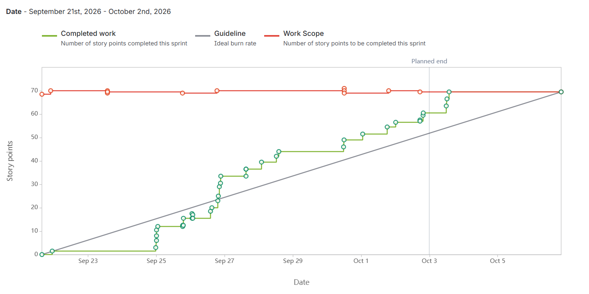
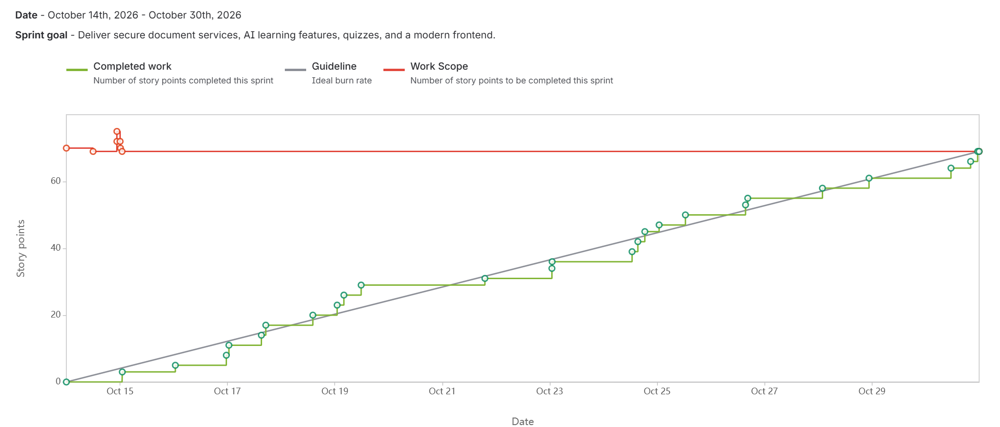

# StudyForge


**Turn your class materials into smarter study resources.**

StudyForge is an AI-powered study platform designed to help college students transform their class materials into personalized study resources and practice tools.

This repository is the shared starting point for a 5-person team: a runnable Django backend, a runnable React frontend, and the architecture contracts the team will implement through Jira tasks.

Automated checks: see [Testing and Bitbucket CI](docs/testing.md) for the shared
Windows/Linux runner, disposable database setup, optional pre-push hook, and
required Cloud settings. Sprint 2 coding tasks must include the
[AI development reports](docs/ai-dev-reports/README.md) in their final commit.

## Table of Contents

- [Description](#description)
- [General Information](#general-information)
- [Technologies](#technologies)
- [Features](#features)
- [Local setup](#local-setup)
- [Expected URLs](#expected-urls)
- [Git workflow](#git-workflow)
- [Documentation](#documentation)
- [Aashish Dhital — Sprint 2 Individual Contributions](#aashish-dhital--sprint-2-individual-contributions)
- [Aashish Dhital — Sprint 3 Next Steps](#aashish-dhital--sprint-3-next-steps)

---

## Description

### Who are we working with?

StudyForge is being developed by a team of five students:

- Gaurav Paneru
- Nischal Rimal
- Sanish Shrestha
- Sudin Katuwal
- Aashish Dhital

As a team, we will collaborate throughout the semester to design, develop, test, and improve StudyForge using an iterative software development process.

### What are we creating?

We are creating an AI-powered study application that allows students to upload their class materials and transform them into useful study resources.

StudyForge is intended to help students generate resources such as summaries, study guides, flashcards, and practice questions based on the materials they provide.

### Who are we creating it for?

StudyForge is primarily designed for college students who want a more efficient and organized way to study and prepare for classes, quizzes, and exams.

It can be especially useful for students who have large amounts of lecture slides, notes, PDFs, and other course materials that they need to review.

### Why are we creating it?

Students often spend a significant amount of time organizing course materials and manually creating study guides, flashcards, summaries, and practice questions before they can begin actively studying.

StudyForge aims to reduce that preparation time by helping students transform their existing course materials into structured study resources.

Our goal is not to replace studying, but to help students spend less time preparing study materials and more time reviewing, practicing, and understanding course content.

### Project Vision

We are working as a team to build an AI-powered study platform for college students so that they can transform their existing class materials into organized, personalized study resources and spend more time actively learning.

---

## General Information

StudyForge is based on the following user story:

> **As a student, I want to turn my class materials into personalized study resources and practice tests so that I can study more efficiently and better understand the material.**

The main problem StudyForge intends to address is the amount of time and effort students spend turning raw course materials into resources that are easier to study from.

Instead of manually creating every summary, study guide, flashcard set, or practice quiz, students will be able to use StudyForge to generate study resources from materials they already have.

### Project Image


The StudyForge project image represents the combination of education and technology. It reflects the idea of taking existing course materials and transforming them into useful tools for learning, reviewing, and practicing course content.

### What We Would Like to Have

As the project develops, we would like to receive feedback from students who use StudyForge in real study situations.

Their feedback could help us determine which features are most useful, identify usability problems, and guide future improvements.

---

## Technologies

| Layer | Technology | Why |
|---|---|---|
| Frontend | React + TypeScript (Vite), PDF.js | SPA with an in-browser PDF viewer for one-click citation checking |
| Backend | Python 3.12, Django, Django REST Framework | REST API, authentication, ORM and migrations in one framework |
| Background jobs | Celery + Redis | Document parsing and embedding run outside the request cycle |
| Document parsing | pypdf, python-pptx | Text extraction with page and slide numbers preserved |
| Database | PostgreSQL + pgvector | Relational data and vector similarity search in one database |
| AI | LLM API and embedding model (provider chosen after our accuracy spike) | Answer generation and retrieval |
| Testing | pytest-django, Vitest, React Testing Library, Mock Service Worker | Backend, frontend and mocked-API tests |
| Containers | Docker, Docker Compose | Reproducible local environment |
| Deployment | Kubernetes (kind for local clusters) | Course requirement; runs web, api, worker and database |
| Source control | Bitbucket + Bitbucket Pipelines | Course requirement; CI on pull requests |
| Project tracking | Jira (Study Forge, key SCRUM) | Course requirement; sprints and user stories |

### Starter code

No starter code is taken from GitHub or any similar site. Projects are generated with the official tools: `django-admin startproject` for the backend and `npm create vite` for the frontend. We reviewed two open-source projects for reference only, without copying code: open-notebook (MIT) and kotaemon (Apache-2.0).

---

## Features

The following features are planned based on the current StudyForge Jira user stories and development tasks.

### 1. User Authentication

**What it does:** Allows students to create an account, securely log in, and log out of StudyForge. Authentication protects courses, uploaded materials, and generated study resources so that students can access only their own data.

**Who uses it:** Students use this feature to securely access their personal StudyForge workspace and protected application features.

### 2. Course Management

**What it does:** Allows students to create one or more courses with a name and optional description. Students can view their course list, rename courses, delete courses with confirmation, and view the materials associated with each course.

**Who uses it:** Students use this feature to organize their study materials and generated resources by class or subject.

### 3. PDF Upload and Processing Status

**What it does:** Allows students to upload PDF course materials to a course and view the processing status of each document.

Uploaded documents can display statuses such as Processing, Ready, or Failed so students know when a document is available for study features. Invalid files, unsupported PDFs, and files that exceed the upload limit are rejected with a clear error message.

**Who uses it:** Students use this feature to add course materials to StudyForge and track when those materials are ready to use.

### 4. Course Material Management

**What it does:** Allows students to view and manage materials uploaded to a course. The material list can display information such as the file name, file type, and upload date.

Students can rename uploaded materials or delete them after confirming the deletion. Deleted materials are no longer available for future study-resource generation.

**Who uses it:** Students use this feature to keep their uploaded course materials organized and up to date.

### 5. Source Selection

**What it does:** Allows students to choose which uploaded materials should be used when asking questions or generating study resources.

Students can select one, multiple, or all materials from a course. StudyForge uses only the selected materials when retrieving information or generating resources, and the selection can remain available during the current session for follow-up requests.

**Who uses it:** Students use this feature when they want StudyForge to focus on specific lectures, notes, or documents instead of every file in a course.

### 6. Page-Cited Question Answering

**What it does:** Allows students to ask questions about their uploaded course materials and receive answers supported by citations.

Answers can include the source document and page number where the information was found. Students can select a citation to open the corresponding PDF at the cited page and verify the information directly.

If the uploaded materials do not contain enough information to answer a question, StudyForge indicates that the answer could not be found instead of relying on unrelated general information.

**Who uses it:** Students use this feature to review course content, ask questions, and verify AI-generated answers against their original class materials.

### 7. Study Guide Generation

**What it does:** Allows students to generate a structured study guide from one or more selected course materials.

Generated study guides can include organized summaries, important terms, and key concepts based only on information retrieved from the selected materials.

**Who uses it:** Students use this feature to quickly create organized review material before quizzes, exams, or study sessions.

### 8. Flashcard Quiz Generation

**What it does:** Allows students to generate practice quizzes from materials associated with a selected course.

Students can answer generated questions and submit their responses while StudyForge tracks their progress through the quiz.

**Who uses it:** Students use this feature to practice recalling and applying information from their course materials.

### 9. Quiz Feedback, Explanations, and Scoring

**What it does:** Provides feedback after students submit quiz answers.

StudyForge indicates whether an answer is correct or incorrect, displays an explanation after each response, tracks quiz progress, and provides a final score or completion summary when the quiz is finished.

**Who uses it:** Students use this feature to identify areas they understand and topics that may require additional review.

### 10. Study Progress Tracking

**What it does:** Allows students to track their study progress for each course.

StudyForge allows students to create study goals, mark goals as completed, view completed and incomplete goals, and see their overall progress for each course.

**Who uses it:** Students use this feature to keep track of their study goals and identify what they have completed and what they still need to work on.

### 11. Study Session Scheduling

**What it does:** Allows students to schedule and manage study sessions for their courses.

StudyForge allows students to create study sessions for a selected course, specify the date, start time, and duration, view upcoming study sessions, and edit or delete scheduled sessions.

**Who uses it:** Students use this feature to organize their study time and prepare for upcoming assignments and exams.

---

As development continues, StudyForge will be expanded through additional sprints based on team priorities, testing results, technical feasibility, and student feedback.

---

## Local setup

### Backend

```bash
cd backend

python3 -m venv venv
source venv/bin/activate

pip install -r requirements.txt

# Before the commands below, export the PostgreSQL connection variables
# listed in backend/.env.example and start your local PostgreSQL database.
python manage.py migrate
python manage.py runserver
```

On Windows, activate the virtual environment with:

```bash
venv\Scripts\activate
```

Use Python 3.12 for the backend. Database configuration uses `POSTGRES_DB`,
`POSTGRES_USER`, `POSTGRES_PASSWORD`, `POSTGRES_HOST`, and `POSTGRES_PORT` from
the process environment. See `backend/.env.example` for the names and local
defaults. Django does not automatically load `.env` files. Keep actual credentials
in your local environment or ignored `.env` file; export them before running
management commands. PostgreSQL, rather than SQLite, is required for SCRUM-9
migration verification.

If you keep local PostgreSQL values in `backend/.env`, load them into the current
PowerShell session from the `backend` directory before running Django:

```powershell
foreach ($line in Get-Content .env) {
    if ($line -match '^(POSTGRES_DB|POSTGRES_USER|POSTGRES_PASSWORD|POSTGRES_HOST|POSTGRES_PORT|CELERY_BROKER_URL|MEDIA_ROOT)=(.*)$') {
        [Environment]::SetEnvironmentVariable($Matches[1], $Matches[2], 'Process')
    }
}
```

### Document upload API (SCRUM-10)

The backend implements authenticated PDF upload and document/status retrieval:

```text
POST /api/v1/courses/{id}/documents/
GET  /api/v1/documents/{id}/
```

Send `Authorization: Bearer <access_token>` and one multipart file field named
`file`. The course must belong to the authenticated user. The inclusive upload
limit is 20 MiB. Structurally valid scanned PDFs are accepted; encrypted,
malformed, empty, and zero-page PDFs are rejected without text extraction.
Responses and error codes follow [the API contract](docs/api-contract.md).

Uploads default to the ignored `backend/media/` directory; `MEDIA_ROOT` can
override it. Files are private: no public media URL is registered. The API and
processing worker must use the same storage and PostgreSQL database.

Set `CELERY_BROKER_URL` to the same broker as Person 4's worker (default
`redis://127.0.0.1:6379/0`). The API publishes
`apps.processing.tasks.process_document_task` with one positional `document_id`
after committing the Document and its initial queued Job. It does not execute
processing, start a worker, or retry publication. Job attempts and worker-side
Job transitions remain Person 4's responsibility; the API marks its Job failed
only when dispatch definitely fails.

An unavailable broker returns the contract's `503` with the saved document ID;
the file is retained. An uncertain send leaves the document state unchanged.
A successful publish does not prove a worker is running: the document can stay
`PENDING` until a worker consumes it. Do not automatically repeat an upload after
an uncertain response.

SCRUM-10 uses SimpleJWT to validate access tokens on these two endpoints. Login,
registration, and token refresh remain the authentication domain's endpoints.
Receive those and the worker through `development` according to the team
workflow. Token issuance and validation must share signing configuration.

With PostgreSQL configured, run the existing schema checks and the focused
SCRUM-10 integration checks with `python manage.py test apps.documents`.

### Backend tests (SCRUM-12)

Activate the Python 3.12 `backend/venv` and start Docker Desktop. The shared runner
creates its own disposable PostgreSQL/pgvector database and temporary storage;
it does not use your development database or `.env`.

```bash
# From the repository root:
python -m pip install -r backend/requirements-dev.txt
python scripts/check.py --component backend --suite documents
```

This runs the SCRUM-12 cases plus existing document model and smoke tests.
Fixtures isolate uploaded files and mock processing dispatch; no Redis or worker
is needed. Coverage includes PDF validation, authentication, ownership, statuses,
and storage/database/dispatch failures, including the empty-multipart regression.

### Frontend

```bash
cd frontend

npm install
npm run dev
```

Copy `frontend/.env.example` to `frontend/.env` before making API calls from the frontend. Do not commit `.env` files.

## Expected URLs

```text
Frontend:
http://localhost:5173

Backend:
http://localhost:8000

Health endpoint:
http://localhost:8000/api/v1/health/
```

## Local infrastructure

Django uses the Docker PostgreSQL database by default (`localhost:5432`, database `studyforge`). Start this stack before `python manage.py migrate`. Set `DATABASE_ENGINE=sqlite3` only if you need the old SQLite file.

### Prerequisites

- Docker Desktop or Docker Engine
- Docker Compose (`docker compose`)

### Start

From the repository root:

```bash
docker compose up -d
```

Defaults are in `docker-compose.yml`. Copy `.env.example` to `.env` only if you need to change them. Do not commit `.env`.

### Check

```bash
docker compose ps
```

You should see:

- `db` — PostgreSQL 16 with pgvector
- `redis` — Redis

Both should become healthy.

### Connection details

When Django or Celery runs on your machine (not inside Compose):

```text
Postgres host: localhost
Postgres port: 5432
Database: studyforge
User: studyforge
Password: studyforge_dev
Redis: redis://localhost:6379/0
```

Django reads the same Postgres values from the environment, with these defaults. That Redis URL is already the Celery default in `backend/config/settings.py`.

If Django later runs inside Compose, Redis would be `redis://redis:6379/0` and Postgres host would be `db`, because those are the service names on the Compose network.

### Verify Postgres

```bash
docker compose exec db psql -U studyforge -d studyforge -c "SELECT 1;"
```

### Verify pgvector

```bash
docker compose exec db psql -U studyforge -d studyforge -c "SELECT extname, extversion FROM pg_extension WHERE extname = 'vector';"
```

You should see a row for `vector`. The extension is created automatically the first time the database volume is initialized.

### Connect Django

From `backend/`:

```bash
pip install -r requirements.txt
python manage.py migrate
```

Django should report `Engine: django.db.backends.postgresql` if you inspect the connection. To confirm:

```bash
python manage.py dbshell
```

Then run:

```sql
SELECT current_database(), current_user;
```

### Verify Redis

```bash
docker compose exec redis redis-cli ping
```

The reply should be `PONG`.

### Stop

```bash
docker compose down
```

This stops the containers and keeps the Postgres data volume.

### Delete local database data

```bash
docker compose down -v
```

WARNING: `-v` deletes the `postgres_data` volume. Local Postgres data is gone. The next `docker compose up -d` creates an empty database and runs the pgvector init script again.

### Port already in use

If `5432` or `6379` is taken, set another host port in `.env` and start again:

```text
POSTGRES_PORT=5433
REDIS_PORT=6380
```

If you change `REDIS_PORT`, also set `CELERY_BROKER_URL` to that port, for example `redis://localhost:6380/0`.

## Git workflow

The team's integration and demo branch is `development` (`dev` in team discussions).
The Sprint 2 process is:

```text
development → feature/SCRUM-XX → Pull Request → development
```

Local `origin/development` history records direct task integrations, including
SCRUM-103 in PR #72 (`a9af77b`) and SCRUM-104 in PR #81 (`eb2140f`). Start new
Jira task branches from up-to-date `development`, use
`feature/SCRUM-XX-short-description` naming, and include the Jira key in commit
messages. Target reviewed task PRs at `development`, run relevant checks, and
record the PR and integrated commit on the Jira task.

The [Git workflow document](docs/git-workflow.md) lists domain owners but retains
older domain-branch instructions. Use the Sprint 2 process above for task starting
points and PR targets. Confirm task-specific exceptions with the team; do not
rebase or force-push shared branches. Release integration into `main` is a
separate team decision.

## Documentation

| Doc | Purpose |
|---|---|
| `docs/architecture.md` | Stack overview and domain ownership |
| `docs/api-contract.md` | Planned REST API contracts |
| `docs/database-schema.md` | Intended data relationships |
| `docs/frontend-guidelines.md` | Frontend folder and API conventions |
| `docs/git-workflow.md` | Branch and pull-request workflow |


## Sprint 1 Burn-Up Chart



# Contributions

**Aashish:** Developed the Courses features, including the course creation form, backend API, database model, dashboard course list, and tests. Set up the repository skeleton and development environment after discussing the structure with the team, and integrated Courses with authentication.

**Jira Task SCRUM-29: Task - Design the create-course form layout**

- Jira Link: https://cs3398-rodians-f26.atlassian.net/browse/SCRUM-29
- Pull Request Link: https://bitbucket.org/mth115_super/studyforge/pull-requests/18

**Jira Task SCRUM-30: Task - Create the Django Course model**

- Jira Link: https://cs3398-rodians-f26.atlassian.net/browse/SCRUM-30
- Pull Request Link: https://bitbucket.org/mth115_super/studyforge/pull-requests/4

**Jira Task SCRUM-31: Task - Create and run the Course database migration**

- Jira Link: https://cs3398-rodians-f26.atlassian.net/browse/SCRUM-31
- Pull Request Link: https://bitbucket.org/mth115_super/studyforge/pull-requests/10

**Jira Task SCRUM-32: Task - Create the Course serializer**

- Jira Link: https://cs3398-rodians-f26.atlassian.net/browse/SCRUM-32
- Pull Request Link: https://bitbucket.org/mth115_super/studyforge/pull-requests/13

**Jira Task SCRUM-33: Task - Build the authenticated create-course API endpoint**

- Jira Link: https://cs3398-rodians-f26.atlassian.net/browse/SCRUM-33
- Pull Request Link: https://bitbucket.org/mth115_super/studyforge/pull-requests/21

**Jira Task SCRUM-34: Task - Display the student’s course list on the dashboard**

- Jira Link: https://cs3398-rodians-f26.atlassian.net/browse/SCRUM-34
- Pull Request Link: https://bitbucket.org/mth115_super/studyforge/pull-requests/29

**Jira Task SCRUM-35: Task - Write backend tests for course creation and ownership**

- Jira Link: https://cs3398-rodians-f26.atlassian.net/browse/SCRUM-35
- Pull Request Link: https://bitbucket.org/mth115_super/studyforge/pull-requests/38

**Jira Task SCRUM-36: Task - Write frontend tests for course-form validation**

- Jira Link: https://cs3398-rodians-f26.atlassian.net/browse/SCRUM-36
- Pull Request Link: https://bitbucket.org/mth115_super/studyforge/pull-requests/40

**Jira Task SCRUM-92: Task - Initialize StudyForge Repository and Development Environment**

- Jira Link: https://cs3398-rodians-f26.atlassian.net/browse/SCRUM-92
- Pull Request Link: https://bitbucket.org/mth115_super/studyforge/pull-requests/2

**Jira Task SCRUM-95: Task - Connect course creation and dashboard to authentication and add course selection**

- Jira Link: https://cs3398-rodians-f26.atlassian.net/browse/SCRUM-95
- Pull Request Link: https://bitbucket.org/mth115_super/studyforge/pull-requests/35

**Nischal:** Developed the authentication features for StudyForge, including the email-based user model, backend registration and JWT endpoints, frontend login and session management, protected API requests, logout, and authentication tests.

**Jira Task SCRUM-56: Task - Design authentication flow**

- Jira Link: https://cs3398-rodians-f26.atlassian.net/browse/SCRUM-56
- Pull Request Link: https://bitbucket.org/mth115_super/studyforge/pull-requests/6

**Jira Task SCRUM-57: Task - Backend registration and login**

- Jira Link: https://cs3398-rodians-f26.atlassian.net/browse/SCRUM-57
- Pull Request Link: https://bitbucket.org/mth115_super/studyforge/pull-requests/19

**Jira Task SCRUM-63: Task - Implement JWT authentication and frontend**

- Jira Link: https://cs3398-rodians-f26.atlassian.net/browse/SCRUM-63
- Pull Request Link: https://bitbucket.org/mth115_super/studyforge/pull-requests/15

**Jira Task SCRUM-94: Task - Build the frontend login flow**

- Jira Link: https://cs3398-rodians-f26.atlassian.net/browse/SCRUM-94
- Pull Request Link: https://bitbucket.org/mth115_super/studyforge/pull-requests/30

**Jira Task SCRUM-58: Task - Implement logout and protected API access**

- Jira Link: https://cs3398-rodians-f26.atlassian.net/browse/SCRUM-58
- Pull Request Link: https://bitbucket.org/mth115_super/studyforge/pull-requests/32

**Jira Task SCRUM-67: Task - Add authentication tests and handle JWT edge cases**

- Jira Link: https://cs3398-rodians-f26.atlassian.net/browse/SCRUM-67
- Pull Request Link: https://bitbucket.org/mth115_super/studyforge/pull-requests/37

### Next sprint steps

- Coordinate the auth API contract with course and document features, then fix any integration issues found in the shared demo flow.
- Add or refine frontend authentication tests for login, logout, restored sessions, and token refresh, and keep the backend auth edge-case tests current.
- Improve the authentication screens' visual polish and usability with consistent spacing, clearer form labels, responsive layouts, and helpful loading and error states; gather teammate feedback during the demo and turn it into follow-up UI fixes.

**Gaurav Paneru:** Built the study guide generation feature end to end. My work
included the API contract, the swappable LLM client with output validation, the
document content retrieval that feeds it, the frontend panel that displays the
result, and the test suite covering the whole workflow. The complete slice was
merged into `development` in
[pull request #47](https://bitbucket.org/mth115_super/studyforge/pull-requests/47).

**Jira Task SCRUM-68: Task - Design Study Guide Data Flow and API**

- Jira Link: https://cs3398-rodians-f26.atlassian.net/browse/SCRUM-68
- Pull Request Link: https://bitbucket.org/mth115_super/studyforge/pull-requests/23

**Jira Task SCRUM-69: Task - Implement Selected Document Content Retrieval**

- Jira Link: https://cs3398-rodians-f26.atlassian.net/browse/SCRUM-69
- Pull Request Link: https://bitbucket.org/mth115_super/studyforge/pull-requests/26

**Jira Task SCRUM-70: Task - Implement LLM Study Guide Generation**

- Jira Link: https://cs3398-rodians-f26.atlassian.net/browse/SCRUM-70
- Pull Request Link: https://bitbucket.org/mth115_super/studyforge/pull-requests/11

**Jira Task SCRUM-71: Task - Build Study Guide Selection and Display Interface**

- Jira Link: https://cs3398-rodians-f26.atlassian.net/browse/SCRUM-71
- Pull Request Link: https://bitbucket.org/mth115_super/studyforge/pull-requests/45

**Jira Task SCRUM-72: Task - Test Study Guide Generation Workflow**

- Jira Link: https://cs3398-rodians-f26.atlassian.net/browse/SCRUM-72
- Pull Request Link: https://bitbucket.org/mth115_super/studyforge/pull-requests/46

**Next steps for Sprint 2 (Gaurav)**

- Wire `authenticatedFetch` into the feature API modules. It implements a
  401-refresh-and-retry but no feature code calls it, so every feature stops
  working 15 minutes after login until the page is reloaded.
- Use the stored embeddings. Every chunk carries a 768-dimension vector that
  nothing reads yet; page-cited question answering is what it unlocks, and that
  is also the prerequisite for quizzes and flashcards.
- Fail honestly on scanned PDFs. A document with no extractable text currently
  reaches READY with zero chunks; the study guide endpoint is the only place
  that notices.
- Show when a study guide was generated and allow a deliberate regenerate, so a
  saved guide is distinguishable from a fresh one.

**Sudin Katuwal:** Developed the document upload and status features, including the API contract, Document/Job models and migrations, protected PDF upload and status endpoints, backend upload tests, and the frontend upload/status interface integrated into course pages.

**Jira Task SCRUM-8: Document API and Status Contract**

- Jira Link: https://cs3398-rodians-f26.atlassian.net/browse/SCRUM-8
- Branch: `feature/SCRUM-8-document-api-status-contract`
- Pull Request Link: https://bitbucket.org/mth115_super/studyforge/pull-requests/7
- Commit Link: https://bitbucket.org/mth115_super/studyforge/commits/4e7604b168ee4e39b9a07381a6df2df3a2a87eb0
- Status: Completed and integrated into `development`.
- Contribution: Defined the PDF upload and document-status API contract, including request/response formats, the 20 MiB upload limit, ownership checks, status transitions, safe errors, and the processing handoff.

**Jira Task SCRUM-9: Document/Job Models and Migrations**

- Jira Link: https://cs3398-rodians-f26.atlassian.net/browse/SCRUM-9
- Branch: `feature/SCRUM-9-document-model-migration`
- Pull Request Link: https://bitbucket.org/mth115_super/studyforge/pull-requests/12
- Commit Link: https://bitbucket.org/mth115_super/studyforge/commits/332d0701d0e0ec745529f5230a8ad2a35d26bfff
- Status: Completed; the integrated commit above is in `development`.
- Contribution: Added the Document and Job models, database migrations, status constraints and indexes, owner/course relationships, and model tests for persistence and data integrity.

**Jira Task SCRUM-10: Protected PDF Upload and Status API**

- Jira Link: https://cs3398-rodians-f26.atlassian.net/browse/SCRUM-10
- Branch: `feature/SCRUM-10-pdf-upload-api`
- Pull Request Link: https://bitbucket.org/mth115_super/studyforge/pull-requests/16
- Commit Link: https://bitbucket.org/mth115_super/studyforge/commits/208bf0b0ed9b20f1001f773c8b27bde0a116b8b5
- Status: Completed; the integrated commit above is in `development`.
- Contribution: Implemented authenticated, owner-protected PDF upload and document-status retrieval, PDF validation, private file storage, and dispatch to the shared processing worker after the database transaction commits.

**Jira Task SCRUM-12: Upload Tests**

- Jira Link: https://cs3398-rodians-f26.atlassian.net/browse/SCRUM-12
- Branch: `feature/SCRUM-12-upload-tests`
- Pull Request Link: https://bitbucket.org/mth115_super/studyforge/pull-requests/22
- Commit Link: https://bitbucket.org/mth115_super/studyforge/commits/f15f3bb9e06917d1d96339f0b3127b3a6b11601c
- Status: Completed and integrated into `development`.
- Contribution: Added backend tests for PDF validation and size limits, authentication, ownership, document statuses, and storage/database/dispatch failures. Configured pytest fixtures and fixed empty multipart requests being classified incorrectly.

**Jira Task SCRUM-14: Frontend Upload and Status UI**

- Jira Link: https://cs3398-rodians-f26.atlassian.net/browse/SCRUM-14
- Branch: `feature/SCRUM-14-upload-status-ui`
- Pull Request Link: https://bitbucket.org/mth115_super/studyforge/pull-requests/42
- Commit Link: https://bitbucket.org/mth115_super/studyforge/commits/b4f33407b663f1f20533043e5977a8bfcd0047db
- Status: UI implementation completed and integrated into `development` through the document domain's [PR #43](https://bitbucket.org/mth115_super/studyforge/pull-requests/43).
- Contribution: Built and integrated the course-page PDF uploader with client-side validation, authenticated multipart requests, status polling, failure recovery, and cleanup of stale requests. Added frontend component and integration tests.
- Verification note: The [upload UI integration notes](docs/scrum-14-upload-ui.md#checks) record that final live verification of the integrated course page through to `READY` remains pending Gemini worker configuration.

**Sudin Katuwal - Next Sprint Plans (Planned Work):**

- Add persistent course-material browsing so students can see previously uploaded documents when they revisit a course.
- Add document rename and delete actions with ownership checks and deletion confirmation.
- Add authenticated, owner-only access to original PDFs for viewing or downloading.
- Improve the materials/upload interface using the team's shared Momentum design direction, including clearer layout, document actions, and upload/status feedback.

**Sanish Shrestha:** Sanish developed the document processing and knowledge-storage foundation for StudyForge. My 
work included asynchronous PDF processing with Celery and Redis, page-aware PDF text extraction, PostgreSQL/
pgvector/Redis local infrastructure, the Chunk data model and vector migration, and the chunking/embedding 
pipeline.

**Jira Task SCRUM-11: Task - Implement Celery task for parsing and status transitions**

- Jira Link: https://cs3398-rodians-f26.atlassian.net/browse/SCRUM-11
- Pull Request Link: https://bitbucket.org/mth115_super/studyforge/pull-requests/5


**Jira Task SCRUM-13: Task - Implement PDF text extraction with page numbers**

- Jira Link: https://cs3398-rodians-f26.atlassian.net/browse/SCRUM-13
- Pull Request Link: https://bitbucket.org/mth115_super/studyforge/pull-requests/9


**Jira Task SCRUM-15: Task - Set up PostgreSQL, pgvector, and Redis with Docker Compose**

- Jira Link: https://cs3398-rodians-f26.atlassian.net/browse/SCRUM-15
- Pull Request Link: https://bitbucket.org/mth115_super/studyforge/pull-requests/14


**Jira Task SCRUM-17: Task - Design Chunk model and pgvector migration**

- Jira Link: https://cs3398-rodians-f26.atlassian.net/browse/SCRUM-17
- Pull Request Link: https://bitbucket.org/mth115_super/studyforge/pull-requests/24

**Jira Task SCRUM-18: Task - Implement chunking and embedding pipeline**

- Jira Link: https://cs3398-rodians-f26.atlassian.net/browse/SCRUM-18
- Pull Request Link: https://bitbucket.org/mth115_super/studyforge/pull-requests/33

## Next Steps — Sprint 2
For Sprint 2, Sanish will extend the document processing and knowledge pipeline so uploaded PDFs can be used for question answering. The work will focus on improving document chunking, reliably storing processed document content, managing vector embeddings with pgvector, and implementing similarity-based retrieval of relevant chunks.
This will support a chat-style feature where a student can ask questions about uploaded course materials and StudyForge can retrieve relevant document sections as context for the AI response. Sanish will also help integrate this backend functionality with the frontend as Sprint 2 places a larger focus on UI, design, and the overall user experience.

## Sprint 2 Burn-Up Chart



## Sanish Shrestha — Sprint 2 Contributions

Sprint 2 extended the Sprint 1 document-processing foundation into an independently deployable worker, secure Django-to-worker document retrieval, vector similarity search, a grounded RAG question API, and a local Kubernetes deployment path. The designated team demo branch is `development`. Git verification found all five task integration commits in `origin/development`; the task records below include repository-verified implementation, commit, branch, test, and pull-request evidence.

### SCRUM-108 — Implement independent worker

- Jira: [SCRUM-108](https://cs3398-rodians-f26.atlassian.net/browse/SCRUM-108)
- Branch: `SCRUM-108-Implement-independent-worker`
- PR: [#59](https://bitbucket.org/mth115_super/studyforge/pull-requests/59)
- Integration commit: [4b51c2b](https://bitbucket.org/mth115_super/studyforge/commits/4b51c2b)
- Commits: [d1a009c2](https://bitbucket.org/mth115_super/studyforge/commits/d1a009c2bd6ae6687e931667654fd32e69bff769), [4b51c2b](https://bitbucket.org/mth115_super/studyforge/commits/4b51c2b)
- Contribution: Implemented the standalone Celery document-processing worker needed to move extraction and embedding work outside the Django request cycle. [`process_document_task`](services/document-processing/processing_service/tasks.py) receives the job ID, document ID, and source digest; [`fetch_source_document`](services/document-processing/processing_service/source_client.py) retrieves and verifies the source; the worker then extracts text, preserves page locations, chunks the content, generates embeddings, and posts authenticated status/result callbacks. Django's [`InternalJobDocumentView`](backend/apps/documents/internal_views.py) and [`InternalJobResultView`](backend/apps/documents/internal_views.py) provide the internal handoff boundary, while callback persistence keeps the application database authoritative for document status and chunks.
- Tests: The architecture verification record reports 321 backend tests and 79 subtests, 41 standalone service tests, Django checks, migration checks, and service verification passing. The implementation reports also record focused callback tests, worker startup checks, duplicate delivery checks, and an end-to-end local worker flow passing.
- Limitations: The architecture record leaves separate delivery retries, durable recovery/reconciliation, and production deployment hardening as follow-up work.

### SCRUM-16 — Vector similarity retrieval

- Jira: [SCRUM-16](https://cs3398-rodians-f26.atlassian.net/browse/SCRUM-16)
- Title note: The repository task report identifies the task as `SCRUM-16-Implement-RAG`; the canonical Jira title is not independently verified here.
- Branch: `SCRUM-16-implement-RAG`
- PR: [#65](https://bitbucket.org/mth115_super/studyforge/pull-requests/65)
- Integration commit: [f83ba33](https://bitbucket.org/mth115_super/studyforge/commits/f83ba33)
- Commits: [f20fe4d](https://bitbucket.org/mth115_super/studyforge/commits/f20fe4d), [b7cf47e](https://bitbucket.org/mth115_super/studyforge/commits/b7cf47e), [37f8e66](https://bitbucket.org/mth115_super/studyforge/commits/37f8e66), [05e789b](https://bitbucket.org/mth115_super/studyforge/commits/05e789b)
- Contribution: Added the retrieval primitive that turns stored document chunks into ranked evidence for future question answering. [`retrieve_chunks`](backend/apps/knowledge/retrieval.py) validates the requested document, owner, READY status, and query inputs before embedding the question and ordering eligible pgvector chunks by cosine distance. The implementation excludes null embeddings, applies deterministic chunk-ID tie-breaking and top-K limits, and supports a configurable similarity boundary. Serializer contracts and focused retrieval tests define the expected result shape and security boundaries.
- Tests: Recorded disposable PostgreSQL/pgvector runs include 16 retrieval tests and 25 subtests passing with Gemini mocked. Later processing/knowledge verification recorded 89 tests and 29 subtests passing, with 14 callback tests and 2 subtests also passing.
- Limitations: Gemini was mocked for these retrieval tests, so live provider behavior and semantic retrieval quality were not established. Production relevance-threshold calibration remains open. A broader suite was blocked by the pre-existing `serializers.TextChoices` collection error.

### SCRUM-20 — Implement RAG questions API

- Jira: [SCRUM-20](https://cs3398-rodians-f26.atlassian.net/browse/SCRUM-20)
- Branch: `SCRUM-20-implement-RAG-questions-API`
- PR: [#69](https://bitbucket.org/mth115_super/studyforge/pull-requests/69)
- Integration commit: [35a90d9](https://bitbucket.org/mth115_super/studyforge/commits/35a90d9)
- Commits: [d5bc4e5](https://bitbucket.org/mth115_super/studyforge/commits/d5bc4e5), [a08cf9f](https://bitbucket.org/mth115_super/studyforge/commits/a08cf9f), [4e3ec24](https://bitbucket.org/mth115_super/studyforge/commits/4e3ec24), [9b67cca](https://bitbucket.org/mth115_super/studyforge/commits/9b67cca), [a992a06](https://bitbucket.org/mth115_super/studyforge/commits/a992a06)
- Contribution: Built the user-facing backend RAG path on top of SCRUM-16 retrieval. [`retrieve_chunks_for_documents`](backend/apps/knowledge/retrieval.py) globally ranks evidence across selected documents; [`answer_question`](backend/apps/knowledge/services.py) sends grounded passages to the answer-generation provider and validates the returned citations; [`RAGQuestionView`](backend/apps/knowledge/views.py) exposes the authenticated question endpoint. Serializer checks ensure citations refer to authorized, current chunks and that insufficient context produces a controlled result.
- Tests: The recorded final regression run reports 144 tests and 206 subtests passing. Earlier PostgreSQL/pgvector verification recorded 28 tests and 72 subtests passing, including multi-document ranking and security behavior.
- Limitations: Frontend integration and live-provider verification were explicitly outside the task scope. The task branch and remote task ref point to `a992a06`.

### SCRUM-100 — Secure internal source-document retrieval

- Jira: [SCRUM-100](https://cs3398-rodians-f26.atlassian.net/browse/SCRUM-100)
- Branch: `SCRUM-100-Retrieval-Endpoints`
- PR: [#71](https://bitbucket.org/mth115_super/studyforge/pull-requests/71)
- Integration commit: [e78e91e](https://bitbucket.org/mth115_super/studyforge/commits/e78e91e)
- Commits: [4965b243](https://bitbucket.org/mth115_super/studyforge/commits/4965b243), [8f9d0205](https://bitbucket.org/mth115_super/studyforge/commits/8f9d0205), [3c92354a](https://bitbucket.org/mth115_super/studyforge/commits/3c92354a), [632da4e7](https://bitbucket.org/mth115_super/studyforge/commits/632da4e7), [a9b669f8](https://bitbucket.org/mth115_super/studyforge/commits/a9b669f8)
- Contribution: Added the authenticated, job-scoped source boundary required by the standalone worker. [`InternalJobDocumentView`](backend/apps/documents/internal_views.py) resolves a job to its private document, rejects stale jobs, streams the stored source without public media exposure, and returns correlation headers. [`fetch_source_document`](services/document-processing/processing_service/source_client.py) authenticates with the processing-service token, rejects redirects and unsupported formats, checks IDs and size, and verifies the downloaded SHA-256 digest before processing.
- Tests: Recorded evidence includes 267 document tests and 45 subtests, 12 standalone source-client tests, and a latest focused security/worker run of 56 tests and 12 subtests. Authenticated live PDF retrieval returned the expected bytes and digest; invalid credentials were rejected.
- Limitations: The recorded live full-processing attempt failed with Gemini `API_KEY_INVALID`, so a successful live PDF-to-READY run is not claimed. Worker assignment, durable callback recovery, production HTTPS enforcement, and production storage behavior remain follow-up concerns.

### SCRUM-110 — Kubernetes deployment for the document-processing service

- Jira: [SCRUM-110](https://cs3398-rodians-f26.atlassian.net/browse/SCRUM-110)
- Branch: `SCRUM-110-Kubernetes-deployment`
- PR: [#78](https://bitbucket.org/mth115_super/studyforge/pull-requests/78)
- Integration commit: [3fa5e88](https://bitbucket.org/mth115_super/studyforge/commits/3fa5e88)
- Commits: [baa4ea4](https://bitbucket.org/mth115_super/studyforge/commits/baa4ea4), [85f1c53](https://bitbucket.org/mth115_super/studyforge/commits/85f1c53), [de239aa](https://bitbucket.org/mth115_super/studyforge/commits/de239aa), [cea8d503](https://bitbucket.org/mth115_super/studyforge/commits/cea8d503)
- Contribution: Added the local kind deployment path for the document-processing worker. [kind-worker.yaml](services/document-processing/kind-worker.yaml) defines the worker deployment and configuration, while [kind-local-worker.md](docs/kind-local-worker.md) documents the local cluster setup, required secrets, Django connectivity, and troubleshooting boundaries. Django and PostgreSQL remain outside the kind worker deployment as described by the deployment documentation.
- Tests: The recorded verification reports 41 targeted Django tests and 54 document-processing tests passing. The manifest and documentation were inspected without claiming a live kind-cluster run.
- Limitations: `kind` and `kubectl` were unavailable during the recorded live verification, so cluster startup, service connectivity, scaling, and live Kubernetes processing are not verified.

### Sanish Shrestha — Sprint 3 Next Steps

These are planned follow-up items, not completed Sprint 2 work:

- Coordinate Vercel frontend deployment with Render backend deployment, including production API origins and environment configuration.
- Configure Render background workers and Redis so Celery processing uses the production queue and broker consistently.
- Add persistent document storage appropriate for deployed environments instead of relying on local development storage.
- Improve Celery task recovery and idempotency, including durable retry/reconciliation behavior and safe duplicate callback handling.
- Run end-to-end tests covering PDF upload, background processing, persistent chunk storage, source retrieval, vector similarity search, and the RAG question endpoint.
- Harden production security and configuration by requiring explicit secrets, enforcing protected transport, reviewing CORS/CSRF and service-token boundaries, and removing development fallbacks.


## Aashish Dhital — Sprint 2 Individual Contributions

Evidence reviewed November 3, 2026. These contributions are supported by Aashish-authored implementation commits, PR merge messages, code, and tests. Each linked integration commit is an ancestor of the local `origin/development` snapshot (`c33c79a`). Squash commits link the integrated changes; they do not imply original task commits remain ancestors. Current remote state and live PR metadata remain unverified.

Task titles describe repository evidence. **TODO: verification required** — confirm exact Jira titles, Sprint 2 assignments/dates (especially SCRUM-120), and Jira completion status. Jira links follow the team's existing project URL.

| Jira task and repository-supported title | Branch | Integrated commit | Pull request | Demo-branch merge status | Implementation |
|---|---|---|---|---|---|
| [SCRUM-87: Course To-Do List](https://cs3398-rodians-f26.atlassian.net/browse/SCRUM-87) | `feature/SCRUM-87-course-todo-list` | [e33f914](https://bitbucket.org/mth115_super/studyforge/commits/e33f914e24af160532b448ca14046644e9305532) | [PR #58](https://bitbucket.org/mth115_super/studyforge/pull-requests/58) | Merged into `development`, 2026-10-17 (local history). | Course-linked tasks, due dates, completion/reopening, owner-protected API, retry-safe creation keys, and dashboard forms/sorting. |
| [SCRUM-82: Basic Study Calendar](https://cs3398-rodians-f26.atlassian.net/browse/SCRUM-82) | `feature/SCRUM-82-study-calendar` | [426d8e6](https://bitbucket.org/mth115_super/studyforge/commits/426d8e655bed05c39e0079705a18bfeeb8aa559b) | [PR #66](https://bitbucket.org/mth115_super/studyforge/pull-requests/66) | Merged into `development`, 2026-10-19 (local history). | StudySession model/migration and authenticated CRUD; monthly calendar combines dated tasks and sessions, with session forms and dashboard calendar. |
| [SCRUM-103: Course Workspace and Pandu Chat](https://cs3398-rodians-f26.atlassian.net/browse/SCRUM-103) | `feature/SCRUM-103-course-workspace-ui` | [a9af77b](https://bitbucket.org/mth115_super/studyforge/commits/a9af77b18fe3a04936dcb5eb80c8fba122447298) | [PR #72](https://bitbucket.org/mth115_super/studyforge/pull-requests/72) | Merged into `development`, 2026-10-24 (local history). | Materials/Notes/Quizzes workspace, keyboard tabs, split layout, Pandu sample controller, source-ID contracts, prompts, sending/streaming presentation, and cancellation. |
| [SCRUM-104: Dashboard Widgets and Course UI](https://cs3398-rodians-f26.atlassian.net/browse/SCRUM-104) | `feature/SCRUM-104-dashboard-widgets` | [eb2140f](https://bitbucket.org/mth115_super/studyforge/commits/eb2140f8e6d12dd479d569549059890247f452a2) | [PR #81](https://bitbucket.org/mth115_super/studyforge/pull-requests/81) | Merged into `development`, 2026-10-30 (local history). | Course-card artwork, sidebar calendar/day activities, course Tasks tab, compact upload UI, searchable materials, short status labels, and Pandu layout polish. |
| [SCRUM-120: Gemini Support for Notes, Quizzes, and Pandu Chat](https://cs3398-rodians-f26.atlassian.net/browse/SCRUM-120) | `feature/switch-openai-to-gemini` | [c33c79a](https://bitbucket.org/mth115_super/studyforge/commits/c33c79a7724b14efdc9773951198a8f2f7034160) | [PR #84](https://bitbucket.org/mth115_super/studyforge/pull-requests/84) | Merged into `development`, 2026-11-01 (local history). | Shared native Gemini JSON transport and provider adapters, bounded retries/timeouts, sanitized failures, response validation, and configuration documentation. |

SCRUM-120 uses `feature/switch-openai-to-gemini`, matching the local branch and `origin` tracking ref at `e63515e`, and the PR #84 merge subject at `c33c79a`. The merge body contains a conflicting branch label. **TODO: verification required** — confirm the source branch displayed on PR #84; its metadata was inaccessible in the earlier review, so the table records the locally evidenced name.

### Aashish Dhital — Sprint 2 Testing Evidence

These are historical records and checked-in coverage, not newly executed test results. No application tests were run for this README-only edit.

| Task | Relevant testing and limitations |
|---|---|
| SCRUM-87 | Merge message records 19 passing frontend API tests plus TypeScript/lint checks. Backend tests cover validation, ownership, ordering, and completion; frontend tests cover forms, retry keys, task panels, and sorting. **TODO: verification required** — final integrated CI result. |
| SCRUM-82 | Merge message records 53 courses-app tests on isolated SQLite, 54 focused frontend tests, 24 calendar tests, and successful build/system checks. These are separate runs, not an additive total. PostgreSQL verification was pending; lint recorded an existing AuthContext warning. **TODO: verification required** — PostgreSQL and final CI evidence. |
| SCRUM-103 | [Workspace verification](docs/course-workspace.md#verification) records 108 tests in 15 frontend files passing October 23. Coverage includes tabs, references, chat states, cancellation, and prompts; fixed the upload-label assertion. Browser viewport/mobile-keyboard checks remained manual. |
| SCRUM-104 | Changed tests cover course-specific tasks, retry/empty states, compact calendar day selection, material search, uploads, workspace tabs, and dashboard behavior. **TODO: verification required** — passing execution/CI evidence for the final task revision. |
| SCRUM-120 | [Offline verification](docs/gemini-generation.md#offline-verification) records 43 tests passing October 31 using mocked SDK calls and real SDK response objects, covering provider selection, validation, grounding, and sanitized errors. No live provider/database integration was performed. |

### Aashish Dhital — Sprint 2 Technical Contributions

Frontend work includes the task dashboard, reusable calendar and session forms, course workspace, Pandu presentation/cancellation controls, and course/material UI refinements. Backend work includes To-Do and StudySession persistence, migrations, authenticated ownership checks, retry-safe creation, and Gemini provider adapters. SCRUM-104's backend change was a comment, not a new endpoint.

Reliability work includes duplicate-create protection, date/time handling without timezone conversion, canceled-response handling, unavailable-source filtering, and the SCRUM-103 test-label fix. Documentation covers the study-session [API contract](docs/api-contract.md) and [schema](docs/database-schema.md), [workspace contracts](docs/course-workspace.md), and [Gemini configuration/testing](docs/gemini-generation.md). Git history includes separate curiosity-report/grade files for SCRUM-87, SCRUM-82, SCRUM-103, and SCRUM-104 in [AI development reports](docs/ai-dev-reports/); their existence does not establish instructor acceptance.

Attribution boundary: SCRUM-103 reused existing materials and study-guide functionality and initially supplied sample chat plus an unavailable quiz tab. Live reference/chat integration (SCRUM-75/76), quiz implementation, multi-material notes (SCRUM-112), and later responsive navigation are teammates' work.

### Aashish Dhital — Sprint 3 Next Steps

**Proposed work for Aashish, subject to team planning:**

- Extend the current completion-only To-Do update API with title/due-date editing and deletion; add confirmation UI and ownership, validation, and calendar-refresh tests.
- Verify task/session migrations and retry-key behavior against PostgreSQL, including concurrent duplicate submissions; attach reproducible results to the task/PR.
- Add browser coverage for course navigation, material search, task completion, calendar/session editing, and chat cancellation. Check keyboard focus, narrow viewports, and the mobile keyboard on the integrated layout.
- Verify configured Gemini generation with real uploaded materials for notes, quizzes, and cited answers; record provider/model configuration and failure behavior without exposing credentials.
- Refresh workspace documentation against `ConnectedCourseChat` and the current quiz/notes panels: its demo-controller and unavailable-feature descriptions predate later integrations.

### Aashish Dhital — Review and Retrospective Verification

Sprint 2 contributions and their Jira, commit, and PR links are documented here. Retrospective submission, Jira completion status, and final CI results require separate verification; the README alone does not establish their completion.

**TODO: verification required** — confirm the supporting review/demo and Sprint 2 progress artifacts, actual retrospective outcomes and agreed improvements, and required original transcripts and separate assessments (including SCRUM-120 if applicable) against the rubric and [reporting instructions](docs/ai-dev-reports/README.md). Technical verification gaps remain listed in the testing table above.

## Gaurav Paneru — Sprint 2 Individual Contributions

Sprint 2 built the quiz feature end to end (models, AI generation, the quiz-taking interface, and server-side scoring with a results page) and extended the Sprint 1 study guide into multi-material AI study notes. All five tasks are integrated into `development`. Test counts below come from the task branches' [curiosity reports](docs/ai-dev-reports/) and were not rerun for this README update.

**Jira Task SCRUM-38: Implement Quiz Database Models & Migrations**

- Jira Link: [SCRUM-38](https://cs3398-rodians-f26.atlassian.net/browse/SCRUM-38)
- Branch: `feature/SCRUM-38-quiz-models`
- Pull Request Link: [PR #55] (https://bitbucket.org/%7Bdd21a7d9-dc9f-4993-84fb-f3559fb45ced%7D/%7B5dd11aba-d6bf-4797-92ee-f7c597473283%7D/pull-requests/55)
- Commit Links: [models and migration](https://bitbucket.org/mth115_super/studyforge/commits/97501e3), [model tests](https://bitbucket.org/mth115_super/studyforge/commits/d38b76d), [schema docs](https://bitbucket.org/mth115_super/studyforge/commits/03967b2), [integration commit](https://bitbucket.org/mth115_super/studyforge/commits/417c4df).
- Status: Integrated into `development` on October 16.
- Contribution: Added the [`Quiz` and `Question` models](backend/apps/quizzes/models.py) and migration: quizzes belong to an owner and course, and questions store ordered options, the correct answer, and an explanation. Validation requires at least two non-empty options, a correct answer that points to one of them, and a quiz owner who owns the course.
- Testing: 11 model tests mapped to the acceptance criteria; the recorded full backend run was 230 tests and 39 subtests passing on disposable PostgreSQL.
- Limitations: Persistence only; generation, answer hiding, and scoring were delivered by the tasks below.

**Jira Task SCRUM-42: Implement AI Quiz Generation Backend & API**

- Jira Link: [SCRUM-42](https://cs3398-rodians-f26.atlassian.net/browse/SCRUM-42)
- Branch: `feature/SCRUM-42-quiz-generation-api`
- Pull Request Link: [PR #61](https://bitbucket.org/mth115_super/studyforge/pull-requests/61)
- Commit Links: [quiz source materials](https://bitbucket.org/mth115_super/studyforge/commits/490e820), [LLM layer and validator](https://bitbucket.org/mth115_super/studyforge/commits/85b0aeb), [generation service](https://bitbucket.org/mth115_super/studyforge/commits/f91323d), [endpoints](https://bitbucket.org/mth115_super/studyforge/commits/1a7547a), [integration merge](https://bitbucket.org/mth115_super/studyforge/commits/e80d723).
- Status: Merged into `development` on October 17.
- Contribution: `POST /api/v1/courses/{id}/quizzes/` generates a 5- or 10-question quiz from selected READY materials. A swappable LLM client (fake, or a real provider) feeds a strict validator, so malformed model output never reaches the database. Answer options are shuffled to remove the model's bias toward the first option, and correct answers and explanations stay hidden until submission.
- Testing: Ownership, READY status, empty-text, model-failure, and answer-hiding tests; the recorded run was 294 backend tests passing, with CI passing.
- Limitations: Long selections are sampled evenly to fit a 60,000-character budget, so a quiz may not draw on every page.

**Jira Task SCRUM-45: Build Interactive Quiz Generation & Taking Interface**

- Jira Link: [SCRUM-45](https://cs3398-rodians-f26.atlassian.net/browse/SCRUM-45)
- Branch: `feature/SCRUM-45-quiz-taking-ui`
- Pull Request Link: [PR #79](https://bitbucket.org/mth115_super/studyforge/pull-requests/79)
- Commit Links: [types and API client](https://bitbucket.org/mth115_super/studyforge/commits/c830235), [setup, player, and results components](https://bitbucket.org/mth115_super/studyforge/commits/165469b), [Quizzes tab](https://bitbucket.org/mth115_super/studyforge/commits/7d40326), [citation repair](https://bitbucket.org/mth115_super/studyforge/commits/b6d6ff5), [backend error detail](https://bitbucket.org/mth115_super/studyforge/commits/ac9e53c), [integration squash](https://bitbucket.org/mth115_super/studyforge/commits/b10b991).
- Status: Squash-merged into `development` on October 29.
- Contribution: Built the [Quizzes tab](frontend/src/components/quizzes/QuizPanel.tsx): choose materials and length, answer one question at a time, move between questions, and submit the whole quiz. Also improved shared AI reliability: Pandu gets one bounded repair attempt when the model returns an invalid citation, and the frontend shows the backend's error detail.
- Testing: The recorded runs were 286 frontend tests and 275 backend tests (45 subtests) passing.
- Limitations: Only one citation repair is attempted; a second invalid citation still returns an error.

**Jira Task SCRUM-51: Implement Quiz Scoring, Progress & Results**

- Jira Link: [SCRUM-51](https://cs3398-rodians-f26.atlassian.net/browse/SCRUM-51)
- Branches: `feature/SCRUM-51-quiz-scoring-results` (backend) and `feature/SCRUM-51-quiz-results-ui` (frontend)
- Pull Request Links: [PR #76](https://bitbucket.org/mth115_super/studyforge/pull-requests/76) and [PR #80](https://bitbucket.org/mth115_super/studyforge/pull-requests/80)
- Commit Links: [submission models](https://bitbucket.org/mth115_super/studyforge/commits/740fa56), [server-side grading](https://bitbucket.org/mth115_super/studyforge/commits/440160d), [submit endpoint](https://bitbucket.org/mth115_super/studyforge/commits/f79f660), [results endpoint](https://bitbucket.org/mth115_super/studyforge/commits/6640e13), [results UI tests](https://bitbucket.org/mth115_super/studyforge/commits/fdfcfe6), [restore after reload](https://bitbucket.org/mth115_super/studyforge/commits/e5648e8), integration squashes [ee31eb0](https://bitbucket.org/mth115_super/studyforge/commits/ee31eb0) and [94e51a9](https://bitbucket.org/mth115_super/studyforge/commits/94e51a9).
- Status: Squash-merged into `development` on October 25 (backend) and October 29 (frontend).
- Contribution: Answers are graded on the server against the stored answer key, so the client cannot change its score. The results page shows the score and percentage and reviews each answer with its explanation, revealed only after submission. A database constraint allows one submission per quiz, even when two submits race. The open quiz or its results come back after a page reload.
- Testing: The recorded runs were 602 backend tests (28 new) and 300 frontend tests passing.
- Limitations: A quiz can be submitted once; retaking means generating a new quiz. The reload restore lasts for the browser session only.

**Jira Task SCRUM-112: Implement Multi-Material AI Study Notes**

- Jira Link: [SCRUM-112](https://cs3398-rodians-f26.atlassian.net/browse/SCRUM-112)
- Branch: `feature/SCRUM-112-multi-material-notes`
- Pull Request Link: [PR #82](https://bitbucket.org/mth115_super/studyforge/pull-requests/82)
- Commit Links: [course notes model](https://bitbucket.org/mth115_super/studyforge/commits/6d6d651), [multi-material generation](https://bitbucket.org/mth115_super/studyforge/commits/398e5bd), [endpoints](https://bitbucket.org/mth115_super/studyforge/commits/2d5fcc7), [shared material picker](https://bitbucket.org/mth115_super/studyforge/commits/aa35e35), [Notes interface](https://bitbucket.org/mth115_super/studyforge/commits/7db8808), [reliability fix](https://bitbucket.org/mth115_super/studyforge/commits/2a7927b), [integration squash](https://bitbucket.org/mth115_super/studyforge/commits/025fef1).
- Status: Squash-merged into `development` on October 31.
- Contribution: Extended the study guide into notes built from one or more selected materials, with headings, key concepts with explanations, and important points (`POST /api/v1/courses/{id}/notes/`, documented in [notes-api.md](docs/notes-api.md)). Large selections are split into labelled batches and merged, and selections over 300,000 characters are rejected rather than sampled. Notes are saved and reopened after a reload, and deleting a material deletes the notes built from it. The material checklist is now shared by Notes and Quizzes.
- Supporting fixes in the same PR: the existing study guide endpoint now returns 503 instead of crashing when the model fails, and a TypeScript error in `CalendarMonth.tsx` that broke `npm run build` was fixed with Aashish's approval.
- Testing: 641 backend and 326 frontend tests passing, with GitHub Actions CI passing. A real-model test with `gpt-4o-mini` found that large batches could silently drop most of a material; after the fix (smaller batches, one retry, and a check for suspiciously short output), three near-limit runs kept all 95 planted facts.
- Limitations: Generation runs inside one request, so a selection near the limit takes about 2 minutes. The output check catches a model that skimmed but cannot prove every detail was kept. The thresholds were tuned on `gpt-4o-mini` with generated test materials; Gemini, now the example backend, reuses the same pipeline but was not tested with it or with real lecture files.

### Gaurav Paneru — Sprint 3 Next Steps (Planned Work)

- Add a repeatable notes evaluation under `eval/` with real lecture files and the facts each must keep, and report coverage, time, and tokens.
- Retest notes and quizzes on Gemini, then tune the batch size, total limit, and output checks from recorded results.
- Measure notes coverage directly instead of by output length, and warn the student when part of a material may be missing.
- Move notes generation to the Celery workers, or run batches in parallel and keep finished ones, so large selections are faster and one failed call does not restart the run.
- Add a browser test of the Notes and Quizzes tabs to CI.

## Sudin Katuwal — Sprint 2 Individual Contributions

Sprint 2 ran October 14–30, 2026. The six task branches below have integration commits in the local `origin/development` history. Task titles are supported by checked-in task reports and merge records; their exact Jira wording, assignment, and workflow status could not be checked directly. PR numbers come from local merge messages, while the Bitbucket pages and final CI results were not independently accessible. Source-branch commits for SCRUM-118, 61, 106, 76, and 75 were squash-merged: their linked integration commits, rather than the original source commits, are ancestors of `origin/development`.

**Jira Task SCRUM-97: Set Up Independent Document Processing Service and Database**

- Jira Link: [SCRUM-97](https://cs3398-rodians-f26.atlassian.net/browse/SCRUM-97)
- Branch: `feature/SCRUM-97-documents-service-setup`
- Pull Request Link: [PR #54](https://bitbucket.org/mth115_super/studyforge/pull-requests/54)
- Commit Links: [service foundation](https://bitbucket.org/mth115_super/studyforge/commits/1c362eb), [processing contract](https://bitbucket.org/mth115_super/studyforge/commits/c54071b), [integration merge](https://bitbucket.org/mth115_super/studyforge/commits/271709df6fbb22c5c19e438864cce26653508f57).
- Status: Merged into the local `origin/development` history on October 15; the source commits are ancestors of the merge.
- Contribution: Added the independent service scaffold, execution model and migration, restricted logical database role, health/readiness probes, opt-in Compose setup, and verification script under [services/document-processing/](services/document-processing/). Sanish implemented the independent Celery worker in SCRUM-108.
- Testing: The [historical foundation record](services/document-processing/README.md#recorded-foundation-verification--october-14-2026) reports nine service tests and 219 backend tests plus 36 subtests passing, along with Compose, migration, isolation, restart, and Redis-outage checks. These tests were not rerun for this README update.
- Limitations: The service shares the PostgreSQL server; the isolation probe directly checked denied reads, not denied writes. Live worker processing, durable recovery, and production deployment were outside this foundation's verified scope.

**Jira Task SCRUM-118: Processing Context / Job Lifecycle**

- Jira Link: [SCRUM-118](https://cs3398-rodians-f26.atlassian.net/browse/SCRUM-118)
- Branch: `feature/SCRUM-118-processing-context-job-lifecycle`
- Pull Request Link: [PR #63](https://bitbucket.org/mth115_super/studyforge/pull-requests/63)
- Commit Links: [callback lifecycle](https://bitbucket.org/mth115_super/studyforge/commits/9cfe5a4), [contract and integration tests](https://bitbucket.org/mth115_super/studyforge/commits/ab2d6e5), [integration squash](https://bitbucket.org/mth115_super/studyforge/commits/ae135ac7908d702b1af016e4873f87690fec6a5a).
- Status: Squash-merged into the local `origin/development` history on October 17; the original task commits are not its ancestors.
- Contribution: Extended Sanish's worker handoff with Django-side callback validation and [result persistence](backend/apps/documents/result_callbacks.py), Document-then-Job locking, stale-job/attempt rejection, atomic chunk and status updates, and a SHA-256 receipt for exact terminal redelivery. Moved the existing processing-token check into `backend/apps/identity/service_auth.py`; the broader shared authorization task belonged to Nischal.
- Testing: Added callback-contract and worker/Django integration tests. The [historical October 17 record](docs/architecture/document-processing-contract.md#local-verification-on-october-17-2026) reports 321 backend tests and 79 subtests, plus 41 service tests, passing with disposable infrastructure and mocked external calls. No live Redis delivery or crash recovery was established.
- Limitations: Worker callback delivery still needs durable result staging and separate delivery retries. The newest-job rule can reject an older result when a newer job never completes; historical terminal jobs have no receipt for duplicate comparison.

**Jira Task SCRUM-61: Implement Course Material Management**

- Jira Link: [SCRUM-61](https://cs3398-rodians-f26.atlassian.net/browse/SCRUM-61)
- Branch: `feature/SCRUM-61-course-material-management`
- Pull Request Link: [PR #64](https://bitbucket.org/mth115_super/studyforge/pull-requests/64)
- Commit Links: [management API](https://bitbucket.org/mth115_super/studyforge/commits/fe50c6c), [deletion service and backend tests](https://bitbucket.org/mth115_super/studyforge/commits/8be8355), [persistent materials UI](https://bitbucket.org/mth115_super/studyforge/commits/c893d43), [rename/delete controls](https://bitbucket.org/mth115_super/studyforge/commits/eba440a), [integration squash](https://bitbucket.org/mth115_super/studyforge/commits/ca7b80d04ce5d0752a459237b5f1d24bbad600c1).
- Status: Squash-merged into the local `origin/development` history on October 18; the original task commits are not its ancestors.
- Contribution: Added owner-protected list, rename, and delete endpoints in `backend/apps/documents/`, plus [persistent course materials](frontend/src/components/courses/CourseMaterials.tsx), inline rename, confirmed deletion, and polling cleanup. Deletion cascades through related application records without removing unrelated materials or quiz records.
- Testing: Added backend ownership, validation, cascade, storage/commit-failure, and callback-race tests, plus frontend API and component tests. The checked-in task report records no test run during its review; a passing final-task run was not verified.
- Limitations: File deletion and the database transaction cannot commit atomically. A failed database commit after file deletion can leave a material row without its source; persisted cleanup and automatic retries remain open.

**Jira Task SCRUM-106: Implement Multi-Format Upload & Text Extraction**

- Jira Link: [SCRUM-106](https://cs3398-rodians-f26.atlassian.net/browse/SCRUM-106)
- Branch: `feature/SCRUM-106-multi-format-upload-text-extraction`
- Pull Request Link: [PR #68](https://bitbucket.org/mth115_super/studyforge/pull-requests/68)
- Commit Links: [upload validation](https://bitbucket.org/mth115_super/studyforge/commits/6824491), [storage and backend tests](https://bitbucket.org/mth115_super/studyforge/commits/a01cc57), [DOCX/PPTX extraction](https://bitbucket.org/mth115_super/studyforge/commits/cc107c3), [worker integration](https://bitbucket.org/mth115_super/studyforge/commits/12d7bc7), [parser tests](https://bitbucket.org/mth115_super/studyforge/commits/62562db), [frontend upload support](https://bitbucket.org/mth115_super/studyforge/commits/6f79c1e), [PPTX table fix](https://bitbucket.org/mth115_super/studyforge/commits/6e92f25), [integration squash](https://bitbucket.org/mth115_super/studyforge/commits/3ff83a74f46b93f016212094d852bebe5f86f139).
- Status: Squash-merged into the local `origin/development` history on October 22; the original task commits are not its ancestors.
- Contribution: Extended the existing PDF pipeline with validated DOCX/PPTX uploads, preserved source formats and locations, added [Office text extraction](services/document-processing/processing_service/document_parser.py), and generalized the upload UI. Adapted Sanish's existing worker interface and downstream labels; this task did not create the original worker or RAG engine.
- Testing: Added format-validation, worker, parser/chunker, frontend, and downstream compatibility tests. A focused pytest attempt in the [task report](docs/ai-dev-reports/curiosity-report-katuwal-SCRUM-106-2026-10-20.md) failed during collection because Django was absent from that environment; a passing final integrated run was not verified.
- Limitations: Speaker notes and image-only text are outside the documented extraction scope. Representative course-file extraction and final CI results need verification.

**Jira Task SCRUM-76: Implement Chat Reference Uploads and Retrieval Filtering**

- Jira Link: [SCRUM-76](https://cs3398-rodians-f26.atlassian.net/browse/SCRUM-76)
- Branch: `feature/SCRUM-76-chat-reference-uploads-retrieval-filtering`
- Pull Request Link: [PR #74](https://bitbucket.org/mth115_super/studyforge/pull-requests/74)
- Commit Links: [conversation model](https://bitbucket.org/mth115_super/studyforge/commits/0c8e225), [document scope](https://bitbucket.org/mth115_super/studyforge/commits/6dea57d), [retrieval filtering](https://bitbucket.org/mth115_super/studyforge/commits/737f36a), [conversation API](https://bitbucket.org/mth115_super/studyforge/commits/2182001), [API tests](https://bitbucket.org/mth115_super/studyforge/commits/ec733a6), [generic-RAG isolation test](https://bitbucket.org/mth115_super/studyforge/commits/5800fc6), [integration squash](https://bitbucket.org/mth115_super/studyforge/commits/a6b509ac8d7f9bdb28ab713c5f27a2d293e2e599).
- Status: Squash-merged into the local `origin/development` history on October 25; the original task commits are not its ancestors.
- Contribution: Added [owned conversations](backend/apps/conversations/models.py), conversation-scoped document uploads and cleanup, authorized reference/question endpoints, and filters that exclude chat uploads from ordinary course materials, notes, quizzes, study guides, and generic RAG selection. Reused Sanish's retrieval and answer engine.
- Testing: Added conversation API, ownership, scope-isolation, cleanup, and generic-RAG regression tests. The checked-in task report records code inspection but no test execution; a passing final-task run was not verified.
- Limitations: Conversation records do not persist messages. File cleanup retains the database/storage atomicity limitation documented in the [API contract](docs/api-contract.md#conversation-scope-and-apis-scrum-76).

**Jira Task SCRUM-75: Implement Reference Selection and Course Chat Integration**

- Jira Link: [SCRUM-75](https://cs3398-rodians-f26.atlassian.net/browse/SCRUM-75)
- Branch: `feature/SCRUM-75-reference-selection-course-chat-integration`
- Pull Request Link: [PR #77](https://bitbucket.org/mth115_super/studyforge/pull-requests/77)
- Commit Links: [conversation client](https://bitbucket.org/mth115_super/studyforge/commits/e528bf8), [reference selection](https://bitbucket.org/mth115_super/studyforge/commits/a9a7904), [connected chat](https://bitbucket.org/mth115_super/studyforge/commits/cae1a5d), [workspace wiring](https://bitbucket.org/mth115_super/studyforge/commits/acfede8), [token-refresh fix](https://bitbucket.org/mth115_super/studyforge/commits/fc63706), [integration squash](https://bitbucket.org/mth115_super/studyforge/commits/1413f491360a8422eb28f173381f79c3183babe0).
- Status: Squash-merged into the local `origin/development` history on October 26; the original task commits are not its ancestors.
- Contribution: Connected Aashish's existing course workspace and sample-chat presentation to the SCRUM-76 conversation APIs through [ConnectedCourseChat](frontend/src/components/chat/ConnectedCourseChat.tsx). Added READY-reference selection, chat uploads, selected-document questions, citations, controlled error states, and per-course browser-session state that survives token refresh. The original workspace UI and backend RAG answer engine were teammates' work.
- Testing: Added conversation-client, reference-selection, and connected-chat tests for selected IDs, citations, upload status, errors, and course separation. The checked-in task report records no test run; a passing final-task run was not verified.
- Limitations: Messages live in browser `sessionStorage`, not backend history; they disappear when the session ends. Answers arrive as one response rather than a live stream, and a hidden assistant may need an accessible new-reply indication.

Supporting Sprint 2 work: Sudin also merged [PR #60](https://bitbucket.org/mth115_super/studyforge/pull-requests/60) for curiosity-report tooling and [PR #62](https://bitbucket.org/mth115_super/studyforge/pull-requests/62) for GitHub Actions checks. No separate Jira assignment was verified for either PR, and the presence of a CI workflow does not prove a passing run for each task.

### Sudin Katuwal — Sprint 3 Next Steps (Planned Work)

- Coordinate durable callback-result staging and separate delivery retries with the worker owner; test redelivery after outages and process restarts.
- Add persisted file-cleanup work with retries for failed database/storage deletion sequences, and verify both missing-file and orphaned-file recovery.
- Test DOCX and PPTX extraction against representative course files; add support where needed for speaker notes, complex tables/charts, and image text without misleading citations.
- Add owned backend chat-message history if cross-tab or cross-device restoration is required, including retention rules and API/frontend tests.
- Verify the integrated upload-to-READY-to-chat path with a live broker, worker, storage, database, and configured provider; record reproducible results and CI run links.
- Improve course-chat accessibility with a new-reply indication when the assistant is hidden, and evaluate live response streaming against the current single-response API.

**Nischal Rimal — Sprint 2:** Developed document authorization, redesigned login and registration, secure session management, responsive navigation and course layout, and Google sign-in. All five tasks were merged into the team's `development` demo branch.

**Jira Task SCRUM-99: Integrate Document Authorization with Identity Service**

- Jira Link: https://cs3398-rodians-f26.atlassian.net/browse/SCRUM-99
- Branch: [feature/SCRUM-99-integrate-doc-authorization-identity](https://bitbucket.org/mth115_super/studyforge/branch/feature/SCRUM-99-integrate-doc-authorization-identity)
- Commit Links: [course ownership](https://bitbucket.org/mth115_super/studyforge/commits/3caf92e), [authorization tests](https://bitbucket.org/mth115_super/studyforge/commits/41a5601), [all task commits](https://bitbucket.org/mth115_super/studyforge/commits/branch/feature/SCRUM-99-integrate-doc-authorization-identity)
- Pull Request Link: https://bitbucket.org/mth115_super/studyforge/pull-requests/67
- Contribution: Centralized course ownership checks and processing-service authentication, with tests for authorization failures. Merged into `development` in [3b087a0](https://bitbucket.org/mth115_super/studyforge/commits/3b087a0).

**Jira Task SCRUM-113: Polish login UI**

- Jira Link: https://cs3398-rodians-f26.atlassian.net/browse/SCRUM-113
- Branch: [feature/SCRUM-113-polish-login-UI](https://bitbucket.org/mth115_super/studyforge/branch/feature/SCRUM-113-polish-login-UI)
- Commit Links: [login redesign](https://bitbucket.org/mth115_super/studyforge/commits/d128c4f), [registration flow](https://bitbucket.org/mth115_super/studyforge/commits/4fc1004), [validation tests](https://bitbucket.org/mth115_super/studyforge/commits/5c0df1a), [all task commits](https://bitbucket.org/mth115_super/studyforge/commits/branch/feature/SCRUM-113-polish-login-UI)
- Pull Request Link: https://bitbucket.org/mth115_super/studyforge/pull-requests/70
- Contribution: Redesigned the login page, added registration and an auth view switch, aligned the pages with the dashboard theme, and tested validation, errors, and loading states. Merged into `development` in [23ac3d1](https://bitbucket.org/mth115_super/studyforge/commits/23ac3d1).

**Jira Task SCRUM-115: User profile menu, secure sign-out, and persistent authentication**

- Jira Link: https://cs3398-rodians-f26.atlassian.net/browse/SCRUM-115
- Branch: [feature/SCRUM-115-profile-signout-session](https://bitbucket.org/mth115_super/studyforge/branch/feature/SCRUM-115-profile-signout-session)
- Commit Links: [refresh-token rotation](https://bitbucket.org/mth115_super/studyforge/commits/5fdc385), [cross-tab session handling](https://bitbucket.org/mth115_super/studyforge/commits/d7ed5e7), [all task commits](https://bitbucket.org/mth115_super/studyforge/commits/branch/feature/SCRUM-115-profile-signout-session)
- Pull Request Link: https://bitbucket.org/mth115_super/studyforge/pull-requests/73
- Contribution: Added the profile menu, token rotation, proactive access-token refresh, cross-tab sign-out, and tests. Merged into `development` in [fa5faf1](https://bitbucket.org/mth115_super/studyforge/commits/fa5faf1).

**Jira Task SCRUM-117: Responsive application layout**

- Jira Link: https://cs3398-rodians-f26.atlassian.net/browse/SCRUM-117
- Branch: [feature/SCRUM-117-responsive-app-layout](https://bitbucket.org/mth115_super/studyforge/branch/feature/SCRUM-117-responsive-app-layout)
- Commit Links: [mobile navigation](https://bitbucket.org/mth115_super/studyforge/commits/04b14bf), [collapsible AI Assistant](https://bitbucket.org/mth115_super/studyforge/commits/686f681), [all task commits](https://bitbucket.org/mth115_super/studyforge/commits/branch/feature/SCRUM-117-responsive-app-layout)
- Pull Request Link: https://bitbucket.org/mth115_super/studyforge/pull-requests/75
- Contribution: Added a mobile navigation drawer, responsive course layout, collapsible AI Assistant, keyboard focus handling, and tests. Merged into `development` in [34d6fa6](https://bitbucket.org/mth115_super/studyforge/commits/34d6fa6).

**Jira Task SCRUM-114: Google sign-in and sign-up**

- Jira Link: https://cs3398-rodians-f26.atlassian.net/browse/SCRUM-114
- Branch: [feature/SCRUM-114-google-sign-in-sign-up](https://bitbucket.org/mth115_super/studyforge/branch/feature/SCRUM-114-google-sign-in-sign-up)
- Commit Links: [backend verification](https://bitbucket.org/mth115_super/studyforge/commits/da1be40), [frontend sign-in](https://bitbucket.org/mth115_super/studyforge/commits/5f91a1e), [all task commits](https://bitbucket.org/mth115_super/studyforge/commits/branch/feature/SCRUM-114-google-sign-in-sign-up)
- Pull Request Link: https://bitbucket.org/mth115_super/studyforge/pull-requests/83
- Contribution: Added Google ID-token verification, Google account identity, frontend sign-in, request-race protection, documentation, and tests. Merged into `development` in [01053d9](https://bitbucket.org/mth115_super/studyforge/commits/01053d9).

### Next sprint steps

- Build account recovery and profile management: let students update their name, add a verified way to link a Google account to an existing password account, and provide password reset. Define the account ownership and reauthentication rules with the team before implementation.
- Harden identity and session consistency: enforce case-insensitive email uniqueness in PostgreSQL, fix password login and concurrent registration around that rule, coordinate sign-in and sign-out across tabs, and design recovery when logout cannot reach the server. Cover the full lifecycle with backend and browser tests.
- Complete the identity-service integration boundary: coordinate with the document and course owners on how ownership checks will work when Identity no longer shares their database, then implement an authenticated service contract with fail-closed outages and non-disclosing authorization errors.
- Add end-to-end browser coverage for the integrated demo path: registration or Google sign-in, session refresh, course navigation, document upload, AI Assistant use, and sign-out on mobile and desktop. Configure the production Google origin and client IDs, and record CI plus deployed-browser results.
