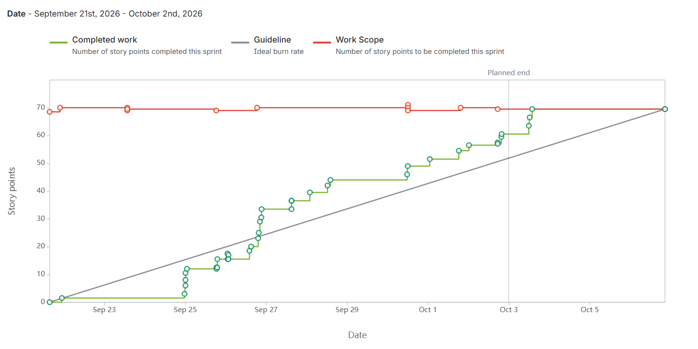

# StudyForge


**Turn your class materials into smarter study resources.**

StudyForge is an AI-powered study platform designed to help college students transform their class materials into personalized study resources and practice tools.

This repository is the shared starting point for a 5-person team: a runnable Django backend, a runnable React frontend, and the architecture contracts the team will implement through Jira tasks.

## Table of Contents

- [Description](#description)
- [General Information](#general-information)
- [Technologies](#technologies)
- [Features](#features)
- [Local setup](#local-setup)
- [Expected URLs](#expected-urls)
- [Git workflow](#git-workflow)
- [Documentation](#documentation)

---

## Description

### Who are we working with?

StudyForge is being developed by a team of five students:

- Gaurav Paneru
- Nischal Rimal
- Sanish Shrestha
- Sudin Katuwal
- Aashish Dhital

As a team, we will collaborate throughout the semester to design, develop, test, and improve StudyForge using an iterative software development process.

### What are we creating?

We are creating an AI-powered study application that allows students to upload their class materials and transform them into useful study resources.

StudyForge is intended to help students generate resources such as summaries, study guides, flashcards, and practice questions based on the materials they provide.

### Who are we creating it for?

StudyForge is primarily designed for college students who want a more efficient and organized way to study and prepare for classes, quizzes, and exams.

It can be especially useful for students who have large amounts of lecture slides, notes, PDFs, and other course materials that they need to review.

### Why are we creating it?

Students often spend a significant amount of time organizing course materials and manually creating study guides, flashcards, summaries, and practice questions before they can begin actively studying.

StudyForge aims to reduce that preparation time by helping students transform their existing course materials into structured study resources.

Our goal is not to replace studying, but to help students spend less time preparing study materials and more time reviewing, practicing, and understanding course content.

### Project Vision

We are working as a team to build an AI-powered study platform for college students so that they can transform their existing class materials into organized, personalized study resources and spend more time actively learning.

---

## General Information

StudyForge is based on the following user story:

> **As a student, I want to turn my class materials into personalized study resources and practice tests so that I can study more efficiently and better understand the material.**

The main problem StudyForge intends to address is the amount of time and effort students spend turning raw course materials into resources that are easier to study from.

Instead of manually creating every summary, study guide, flashcard set, or practice quiz, students will be able to use StudyForge to generate study resources from materials they already have.

### Project Image


The StudyForge project image represents the combination of education and technology. It reflects the idea of taking existing course materials and transforming them into useful tools for learning, reviewing, and practicing course content.

### What We Would Like to Have

As the project develops, we would like to receive feedback from students who use StudyForge in real study situations.

Their feedback could help us determine which features are most useful, identify usability problems, and guide future improvements.

---

## Technologies

| Layer | Technology | Why |
|---|---|---|
| Frontend | React + TypeScript (Vite), PDF.js | SPA with an in-browser PDF viewer for one-click citation checking |
| Backend | Python 3.12, Django, Django REST Framework | REST API, authentication, ORM and migrations in one framework |
| Background jobs | Celery + Redis | Document parsing and embedding run outside the request cycle |
| Document parsing | pypdf, python-pptx | Text extraction with page and slide numbers preserved |
| Database | PostgreSQL + pgvector | Relational data and vector similarity search in one database |
| AI | LLM API and embedding model (provider chosen after our accuracy spike) | Answer generation and retrieval |
| Testing | pytest-django, Vitest, React Testing Library, Mock Service Worker | Backend, frontend and mocked-API tests |
| Containers | Docker, Docker Compose | Reproducible local environment |
| Deployment | Kubernetes (kind for local clusters) | Course requirement; runs web, api, worker and database |
| Source control | Bitbucket + Bitbucket Pipelines | Course requirement; CI on pull requests |
| Project tracking | Jira (Study Forge, key SCRUM) | Course requirement; sprints and user stories |

### Starter code

No starter code is taken from GitHub or any similar site. Projects are generated with the official tools: `django-admin startproject` for the backend and `npm create vite` for the frontend. We reviewed two open-source projects for reference only, without copying code: open-notebook (MIT) and kotaemon (Apache-2.0).

---

## Features

The following features are planned based on the current StudyForge Jira user stories and development tasks.

### 1. User Authentication

**What it does:** Allows students to create an account, securely log in, and log out of StudyForge. Authentication protects courses, uploaded materials, and generated study resources so that students can access only their own data.

**Who uses it:** Students use this feature to securely access their personal StudyForge workspace and protected application features.

### 2. Course Management

**What it does:** Allows students to create one or more courses with a name and optional description. Students can view their course list, rename courses, delete courses with confirmation, and view the materials associated with each course.

**Who uses it:** Students use this feature to organize their study materials and generated resources by class or subject.

### 3. PDF Upload and Processing Status

**What it does:** Allows students to upload PDF course materials to a course and view the processing status of each document.

Uploaded documents can display statuses such as Processing, Ready, or Failed so students know when a document is available for study features. Invalid files, unsupported PDFs, and files that exceed the upload limit are rejected with a clear error message.

**Who uses it:** Students use this feature to add course materials to StudyForge and track when those materials are ready to use.

### 4. Course Material Management

**What it does:** Allows students to view and manage materials uploaded to a course. The material list can display information such as the file name, file type, and upload date.

Students can rename uploaded materials or delete them after confirming the deletion. Deleted materials are no longer available for future study-resource generation.

**Who uses it:** Students use this feature to keep their uploaded course materials organized and up to date.

### 5. Source Selection

**What it does:** Allows students to choose which uploaded materials should be used when asking questions or generating study resources.

Students can select one, multiple, or all materials from a course. StudyForge uses only the selected materials when retrieving information or generating resources, and the selection can remain available during the current session for follow-up requests.

**Who uses it:** Students use this feature when they want StudyForge to focus on specific lectures, notes, or documents instead of every file in a course.

### 6. Page-Cited Question Answering

**What it does:** Allows students to ask questions about their uploaded course materials and receive answers supported by citations.

Answers can include the source document and page number where the information was found. Students can select a citation to open the corresponding PDF at the cited page and verify the information directly.

If the uploaded materials do not contain enough information to answer a question, StudyForge indicates that the answer could not be found instead of relying on unrelated general information.

**Who uses it:** Students use this feature to review course content, ask questions, and verify AI-generated answers against their original class materials.

### 7. Study Guide Generation

**What it does:** Allows students to generate a structured study guide from one or more selected course materials.

Generated study guides can include organized summaries, important terms, and key concepts based only on information retrieved from the selected materials.

**Who uses it:** Students use this feature to quickly create organized review material before quizzes, exams, or study sessions.

### 8. Flashcard Quiz Generation

**What it does:** Allows students to generate practice quizzes from materials associated with a selected course.

Students can answer generated questions and submit their responses while StudyForge tracks their progress through the quiz.

**Who uses it:** Students use this feature to practice recalling and applying information from their course materials.

### 9. Quiz Feedback, Explanations, and Scoring

**What it does:** Provides feedback after students submit quiz answers.

StudyForge indicates whether an answer is correct or incorrect, displays an explanation after each response, tracks quiz progress, and provides a final score or completion summary when the quiz is finished.

**Who uses it:** Students use this feature to identify areas they understand and topics that may require additional review.

### 10. Study Progress Tracking

**What it does:** Allows students to track their study progress for each course.

StudyForge allows students to create study goals, mark goals as completed, view completed and incomplete goals, and see their overall progress for each course.

**Who uses it:** Students use this feature to keep track of their study goals and identify what they have completed and what they still need to work on.

### 11. Study Session Scheduling

**What it does:** Allows students to schedule and manage study sessions for their courses.

StudyForge allows students to create study sessions for a selected course, specify the date, start time, and duration, view upcoming study sessions, and edit or delete scheduled sessions.

**Who uses it:** Students use this feature to organize their study time and prepare for upcoming assignments and exams.

---

As development continues, StudyForge will be expanded through additional sprints based on team priorities, testing results, technical feasibility, and student feedback.

---

## Local setup

### Backend

```bash
cd backend

python3 -m venv venv
source venv/bin/activate

pip install -r requirements.txt

# Before the commands below, export the PostgreSQL connection variables
# listed in backend/.env.example and start your local PostgreSQL database.
python manage.py migrate
python manage.py runserver
```

On Windows, activate the virtual environment with:

```bash
venv\Scripts\activate
```

Use Python 3.12 for the backend. Database configuration uses `POSTGRES_DB`,
`POSTGRES_USER`, `POSTGRES_PASSWORD`, `POSTGRES_HOST`, and `POSTGRES_PORT` from
the process environment. See `backend/.env.example` for the names and local
defaults. Django does not automatically load `.env` files. Keep actual credentials
in your local environment or ignored `.env` file; export them before running
management commands. PostgreSQL, rather than SQLite, is required for SCRUM-9
migration verification.

If you keep local PostgreSQL values in `backend/.env`, load them into the current
PowerShell session from the `backend` directory before running Django:

```powershell
foreach ($line in Get-Content .env) {
    if ($line -match '^(POSTGRES_DB|POSTGRES_USER|POSTGRES_PASSWORD|POSTGRES_HOST|POSTGRES_PORT|CELERY_BROKER_URL|MEDIA_ROOT)=(.*)$') {
        [Environment]::SetEnvironmentVariable($Matches[1], $Matches[2], 'Process')
    }
}
```

### Document upload API (SCRUM-10)

The backend implements authenticated PDF upload and document/status retrieval:

```text
POST /api/v1/courses/{id}/documents/
GET  /api/v1/documents/{id}/
```

Send `Authorization: Bearer <access_token>` and one multipart file field named
`file`. The course must belong to the authenticated user. The inclusive upload
limit is 20 MiB. Structurally valid scanned PDFs are accepted; encrypted,
malformed, empty, and zero-page PDFs are rejected without text extraction.
Responses and error codes follow [the API contract](docs/api-contract.md).

Uploads default to the ignored `backend/media/` directory; `MEDIA_ROOT` can
override it. Files are private: no public media URL is registered. The API and
processing worker must use the same storage and PostgreSQL database.

Set `CELERY_BROKER_URL` to the same broker as Person 4's worker (default
`redis://127.0.0.1:6379/0`). The API publishes
`apps.processing.tasks.process_document_task` with one positional `document_id`
after committing the Document and its initial queued Job. It does not execute
processing, start a worker, or retry publication. Job attempts and worker-side
Job transitions remain Person 4's responsibility; the API marks its Job failed
only when dispatch definitely fails.

An unavailable broker returns the contract's `503` with the saved document ID;
the file is retained. An uncertain send leaves the document state unchanged.
A successful publish does not prove a worker is running: the document can stay
`PENDING` until a worker consumes it. Do not automatically repeat an upload after
an uncertain response.

SCRUM-10 uses SimpleJWT to validate access tokens on these two endpoints. Login,
registration, and token refresh remain the authentication domain's endpoints.
Receive those and the worker through `development` according to the team
workflow. Token issuance and validation must share signing configuration.

With PostgreSQL configured, run the existing schema checks and the focused
SCRUM-10 integration checks with `python manage.py test apps.documents`.

### Backend tests (SCRUM-12)

Activate `backend/venv`, export the `POSTGRES_*` variables described above, and
keep local PostgreSQL running. Its user needs permission to create the separate
`test_<POSTGRES_DB>` database, which Django removes after the run.

```bash
# From the repository root:
python -m pip install -r backend/requirements-dev.txt
python -m pytest backend/tests/documents backend/apps/documents -q
```

This runs the SCRUM-12 cases plus existing document model and smoke tests.
Fixtures isolate uploaded files and mock processing dispatch; no Redis or worker
is needed. Coverage includes PDF validation, authentication, ownership, statuses,
and storage/database/dispatch failures, including the empty-multipart regression.

### Frontend

```bash
cd frontend

npm install
npm run dev
```

Copy `frontend/.env.example` to `frontend/.env` before making API calls from the frontend. Do not commit `.env` files.

## Expected URLs

```text
Frontend:
http://localhost:5173

Backend:
http://localhost:8000

Health endpoint:
http://localhost:8000/api/v1/health/
```

## Local infrastructure

Django uses the Docker PostgreSQL database by default (`localhost:5432`, database `studyforge`). Start this stack before `python manage.py migrate`. Set `DATABASE_ENGINE=sqlite3` only if you need the old SQLite file.

### Prerequisites

- Docker Desktop or Docker Engine
- Docker Compose (`docker compose`)

### Start

From the repository root:

```bash
docker compose up -d
```

Defaults are in `docker-compose.yml`. Copy `.env.example` to `.env` only if you need to change them. Do not commit `.env`.

### Check

```bash
docker compose ps
```

You should see:

- `db` — PostgreSQL 16 with pgvector
- `redis` — Redis

Both should become healthy.

### Connection details

When Django or Celery runs on your machine (not inside Compose):

```text
Postgres host: localhost
Postgres port: 5432
Database: studyforge
User: studyforge
Password: studyforge_dev
Redis: redis://localhost:6379/0
```

Django reads the same Postgres values from the environment, with these defaults. That Redis URL is already the Celery default in `backend/config/settings.py`.

If Django later runs inside Compose, Redis would be `redis://redis:6379/0` and Postgres host would be `db`, because those are the service names on the Compose network.

### Verify Postgres

```bash
docker compose exec db psql -U studyforge -d studyforge -c "SELECT 1;"
```

### Verify pgvector

```bash
docker compose exec db psql -U studyforge -d studyforge -c "SELECT extname, extversion FROM pg_extension WHERE extname = 'vector';"
```

You should see a row for `vector`. The extension is created automatically the first time the database volume is initialized.

### Connect Django

From `backend/`:

```bash
pip install -r requirements.txt
python manage.py migrate
```

Django should report `Engine: django.db.backends.postgresql` if you inspect the connection. To confirm:

```bash
python manage.py dbshell
```

Then run:

```sql
SELECT current_database(), current_user;
```

### Verify Redis

```bash
docker compose exec redis redis-cli ping
```

The reply should be `PONG`.

### Stop

```bash
docker compose down
```

This stops the containers and keeps the Postgres data volume.

### Delete local database data

```bash
docker compose down -v
```

WARNING: `-v` deletes the `postgres_data` volume. Local Postgres data is gone. The next `docker compose up -d` creates an empty database and runs the pgvector init script again.

### Port already in use

If `5432` or `6379` is taken, set another host port in `.env` and start again:

```text
POSTGRES_PORT=5433
REDIS_PORT=6380
```

If you change `REDIS_PORT`, also set `CELERY_BROKER_URL` to that port, for example `redis://localhost:6380/0`.

## Git workflow

Create each Jira task branch from its domain branch. Completed work is merged
through pull requests: **Jira task -> domain -> development -> main**.
To receive another domain's shared work, merge `development` into your domain
branch, then merge the updated domain into any active task branch.

For example, Person 3 starts a new task from the document domain:

```bash
git fetch origin
git switch feature/document-upload-status
git pull --ff-only origin feature/document-upload-status
git switch -c feature/SCRUM-XX-short-description
```

See [Git workflow](docs/git-workflow.md) for domain owners, update commands, and
pull-request targets. The branch called `dev` in team discussions is named
`development` in this repository.

## Documentation

| Doc | Purpose |
|---|---|
| `docs/architecture.md` | Stack overview and domain ownership |
| `docs/api-contract.md` | Planned REST API contracts |
| `docs/database-schema.md` | Intended data relationships |
| `docs/frontend-guidelines.md` | Frontend folder and API conventions |
| `docs/git-workflow.md` | Branch and pull-request workflow |


## Sprint 1 Burn-Up Chart



# Contributions

**Aashish:** Developed the Courses features, including the course creation form, backend API, database model, dashboard course list, and tests. Set up the repository skeleton and development environment after discussing the structure with the team, and integrated Courses with authentication.

**Jira Task SCRUM-29: Task - Design the create-course form layout**

- Jira Link: https://cs3398-rodians-f26.atlassian.net/browse/SCRUM-29
- Pull Request Link: https://bitbucket.org/mth115_super/studyforge/pull-requests/18

**Jira Task SCRUM-30: Task - Create the Django Course model**

- Jira Link: https://cs3398-rodians-f26.atlassian.net/browse/SCRUM-30
- Pull Request Link: https://bitbucket.org/mth115_super/studyforge/pull-requests/4

**Jira Task SCRUM-31: Task - Create and run the Course database migration**

- Jira Link: https://cs3398-rodians-f26.atlassian.net/browse/SCRUM-31
- Pull Request Link: https://bitbucket.org/mth115_super/studyforge/pull-requests/10

**Jira Task SCRUM-32: Task - Create the Course serializer**

- Jira Link: https://cs3398-rodians-f26.atlassian.net/browse/SCRUM-32
- Pull Request Link: https://bitbucket.org/mth115_super/studyforge/pull-requests/13

**Jira Task SCRUM-33: Task - Build the authenticated create-course API endpoint**

- Jira Link: https://cs3398-rodians-f26.atlassian.net/browse/SCRUM-33
- Pull Request Link: https://bitbucket.org/mth115_super/studyforge/pull-requests/21

**Jira Task SCRUM-34: Task - Display the student’s course list on the dashboard**

- Jira Link: https://cs3398-rodians-f26.atlassian.net/browse/SCRUM-34
- Pull Request Link: https://bitbucket.org/mth115_super/studyforge/pull-requests/29

**Jira Task SCRUM-35: Task - Write backend tests for course creation and ownership**

- Jira Link: https://cs3398-rodians-f26.atlassian.net/browse/SCRUM-35
- Pull Request Link: https://bitbucket.org/mth115_super/studyforge/pull-requests/38

**Jira Task SCRUM-36: Task - Write frontend tests for course-form validation**

- Jira Link: https://cs3398-rodians-f26.atlassian.net/browse/SCRUM-36
- Pull Request Link: https://bitbucket.org/mth115_super/studyforge/pull-requests/40

**Jira Task SCRUM-92: Task - Initialize StudyForge Repository and Development Environment**

- Jira Link: https://cs3398-rodians-f26.atlassian.net/browse/SCRUM-92
- Pull Request Link: https://bitbucket.org/mth115_super/studyforge/pull-requests/2

**Jira Task SCRUM-95: Task - Connect course creation and dashboard to authentication and add course selection**

- Jira Link: https://cs3398-rodians-f26.atlassian.net/browse/SCRUM-95
- Pull Request Link: https://bitbucket.org/mth115_super/studyforge/pull-requests/35

## Sprint 1 Contributions — Nischal Rimal

### Completed Jira tasks

 
| Jira task | Work delivered | Branch / Bitbucket PR |
|---|---|---|
| [SCRUM-56 — Design authentication flow](https://cs3398-rodians-f26.atlassian.net/browse/SCRUM-56) |
 Established the email-based custom user model and registration flow
 . 
| [`feature/user-authentication-SCRUM-56-design-auth-flow`]

(https://bitbucket.org/mth115_super/studyforge/src/166784f39cceb07e84504bc8029d755208833379/?at=feature%2Fuser-authentication-SCRUM-56-design-auth-flow)·

 [PR #6] (https://bitbucket.org/mth115_super/studyforge/pull-requests/6) |

| [SCRUM-57 — Backend registration and login](https://cs3398-rodians-f26.atlassian.net/browse/SCRUM-57) |

 Added the email-based user manager and backend registration/login foundation.
  |
 [`feature/user-authentication-SCRUM-57-backend-registration-login`]

  (https://bitbucket.org/mth115_super/studyforge/src/7bd37c07df9d67b9482a24506380546446179dfd/?at=feature%2Fuser-authentication-SCRUM-57-backend-registration-login)· 
  
  [PR #19](https://bitbucket.org/mth115_super/studyforge/pull-requests/19) |

| [SCRUM-63 — Implement JWT authentication and frontend] (https://cs3398-rodians-f26.atlassian.net/browse/SCRUM-63) | 

Added JWT configuration and backend authentication endpoints, plus the frontend login client. | 

[`feature/user-authentication-SCRUM-63-Implement-JWT-Authentication-and-Frontend`]

(https://bitbucket.org/mth115_super/studyforge/src/b0cd18c73ee9b6cfb14062178b0efb368396d431/?at=feature%2Fuser-authentication-SCRUM-63-Implement-JWT-Authentication-and-Frontend) · 

[PR #15](https://bitbucket.org/mth115_super/studyforge/pull-requests/15) |

| SCRUM-94 — Frontend login (https://cs3398-rodians-f26.atlassian.net/browse/SCRUM-94) | 

Built the login screen, in-memory auth context, bearer-token API support, and refresh-cookie session restoration. | 

[`feature/user-authentication-SCRUM-94-frontend-login`]

https://bitbucket.org/mth115_super/studyforge/src/f308eb3dcbff6df6eaf3822ea3820e69a59e21a9/?at=feature%2Fuser-authentication-SCRUM-94-frontend-login· 

[PR #30](https://bitbucket.org/mth115_super/studyforge/pull-requests/30) |

| [SCRUM-58 — Logout and protected API access](https://cs3398-rodians-f26.atlassian.net/browse/SCRUM-58) | 

Added logout and protected-request defaults in the frontend.

 | [`feature/user-authentication-SCRUM-58-logout-protected-api-access`]
 
 (https://bitbucket.org/mth115_super/studyforge/src/1a26fad3642d3522df6e8b04f43f42021d126aaa/?at=feature%2Fuser-authentication-SCRUM-58-logout-protected-api-access) · 
 
 [PR #32](https://bitbucket.org/mth115_super/studyforge/pull-requests/32) |

| [SCRUM-67 — Authentication tests and JWT edge cases](https://cs3398-rodians-f26.atlassian.net/browse/SCRUM-67| )

Added registration, login, and protected-access tests; handled expired/replayed refresh tokens and requests that need token refresh. |

 [`feature/user-authentication-SCRUM-67-auth-jwt-tests`]
 
 (https://bitbucket.org/mth115_super/studyforge/src/673cc1194967335cd7818420de05dea20dd7ac00/?at=feature%2Fuser-authentication-SCRUM-67-auth-jwt-tests )· 
 
 [PR #37] (https://bitbucket.org/mth115_super/studyforge/pull-requests/37) |

The authentication domain was then merged into `development` by [PR #44]

(https://bitbucket.org/mth115_super/studyforge/pull-requests/44). 

Examples of merged implementation and test files include [`AuthContext.tsx`](frontend/src/context/AuthContext.tsx), [`client.ts`](frontend/src/api/client.ts), [`views.py`](backend/apps/users/views.py), and the [user authentication tests](backend/tests/users/).

### Next sprint steps

- Coordinate the auth API contract with course and document features, then fix any integration issues found in the shared demo flow.
- Add or refine frontend authentication tests for login, logout, restored sessions, and token refresh, and keep the backend auth edge-case tests current.
- Improve the authentication screens' visual polish and usability with consistent spacing, clearer form labels, responsive layouts, and helpful loading and error states; gather teammate feedback during the demo and turn it into follow-up UI fixes.

### Individual retrospective contribution

**What went well:** I delivered the authentication flow across the backend and frontend in task-sized branches, and merged it into the shared `development` branch. The work now includes registration/login, protected requests, logout, session restoration, token refresh, and focused auth tests.

**What I will improve and how the team can see it:** I will raise cross-domain API dependencies earlier and post a brief integration status when an auth change affects another feature. The team can track this through Jira task comments and the pull request checklist before each task is merged.

**Sanish Shrestha:** Sanish developed the document processing and knowledge-storage foundation for StudyForge. My 
work included asynchronous PDF processing with Celery and Redis, page-aware PDF text extraction, PostgreSQL/
pgvector/Redis local infrastructure, the Chunk data model and vector migration, and the chunking/embedding 
pipeline.

**Jira Task SCRUM-11: Task - Implement Celery task for parsing and status transitions**

- Jira Link: https://cs3398-rodians-f26.atlassian.net/browse/SCRUM-11
- Pull Request Link: https://bitbucket.org/mth115_super/studyforge/pull-requests/5


**Jira Task SCRUM-13: Task - Implement PDF text extraction with page numbers**

- Jira Link: https://cs3398-rodians-f26.atlassian.net/browse/SCRUM-13
- Pull Request Link: https://bitbucket.org/mth115_super/studyforge/pull-requests/9


**Jira Task SCRUM-15: Task - Set up PostgreSQL, pgvector, and Redis with Docker Compose**

- Jira Link: https://cs3398-rodians-f26.atlassian.net/browse/SCRUM-15
- Pull Request Link: https://bitbucket.org/mth115_super/studyforge/pull-requests/14


**Jira Task SCRUM-17: Task - Design Chunk model and pgvector migration**

- Jira Link: https://cs3398-rodians-f26.atlassian.net/browse/SCRUM-17
- Pull Request Link: https://bitbucket.org/mth115_super/studyforge/pull-requests/24

**Jira Task SCRUM-18: Task - Implement chunking and embedding pipeline**

- Jira Link: https://cs3398-rodians-f26.atlassian.net/browse/SCRUM-18
- Pull Request Link: https://bitbucket.org/mth115_super/studyforge/pull-requests/33

**Sudin Katuwal:** Developed the document upload and status features, including the API contract, Document/Job models and migrations, protected PDF upload and status endpoints, backend upload tests, and the frontend upload/status interface integrated into course pages.

**Jira Task SCRUM-8: Document API and Status Contract**

- Jira Link: https://cs3398-rodians-f26.atlassian.net/browse/SCRUM-8
- Branch: `feature/SCRUM-8-document-api-status-contract`
- Pull Request Link: https://bitbucket.org/mth115_super/studyforge/pull-requests/7
- Commit Link: https://bitbucket.org/mth115_super/studyforge/commits/4e7604b168ee4e39b9a07381a6df2df3a2a87eb0
- Status: Completed and integrated into `development`.
- Contribution: Defined the PDF upload and document-status API contract, including request/response formats, the 20 MiB upload limit, ownership checks, status transitions, safe errors, and the processing handoff.

**Jira Task SCRUM-9: Document/Job Models and Migrations**

- Jira Link: https://cs3398-rodians-f26.atlassian.net/browse/SCRUM-9
- Branch: `feature/SCRUM-9-document-model-migration`
- Pull Request Link: https://bitbucket.org/mth115_super/studyforge/pull-requests/12
- Commit Link: https://bitbucket.org/mth115_super/studyforge/commits/332d0701d0e0ec745529f5230a8ad2a35d26bfff
- Status: Completed; the integrated commit above is in `development`.
- Contribution: Added the Document and Job models, database migrations, status constraints and indexes, owner/course relationships, and model tests for persistence and data integrity.

**Jira Task SCRUM-10: Protected PDF Upload and Status API**

- Jira Link: https://cs3398-rodians-f26.atlassian.net/browse/SCRUM-10
- Branch: `feature/SCRUM-10-pdf-upload-api`
- Pull Request Link: https://bitbucket.org/mth115_super/studyforge/pull-requests/16
- Commit Link: https://bitbucket.org/mth115_super/studyforge/commits/208bf0b0ed9b20f1001f773c8b27bde0a116b8b5
- Status: Completed; the integrated commit above is in `development`.
- Contribution: Implemented authenticated, owner-protected PDF upload and document-status retrieval, PDF validation, private file storage, and dispatch to the shared processing worker after the database transaction commits.

**Jira Task SCRUM-12: Upload Tests**

- Jira Link: https://cs3398-rodians-f26.atlassian.net/browse/SCRUM-12
- Branch: `feature/SCRUM-12-upload-tests`
- Pull Request Link: https://bitbucket.org/mth115_super/studyforge/pull-requests/22
- Commit Link: https://bitbucket.org/mth115_super/studyforge/commits/f15f3bb9e06917d1d96339f0b3127b3a6b11601c
- Status: Completed and integrated into `development`.
- Contribution: Added backend tests for PDF validation and size limits, authentication, ownership, document statuses, and storage/database/dispatch failures. Configured pytest fixtures and fixed empty multipart requests being classified incorrectly.

**Jira Task SCRUM-14: Frontend Upload and Status UI**

- Jira Link: https://cs3398-rodians-f26.atlassian.net/browse/SCRUM-14
- Branch: `feature/SCRUM-14-upload-status-ui`
- Pull Request Link: https://bitbucket.org/mth115_super/studyforge/pull-requests/42
- Commit Link: https://bitbucket.org/mth115_super/studyforge/commits/b4f33407b663f1f20533043e5977a8bfcd0047db
- Status: UI implementation completed and integrated into `development` through the document domain's [PR #43](https://bitbucket.org/mth115_super/studyforge/pull-requests/43).
- Contribution: Built and integrated the course-page PDF uploader with client-side validation, authenticated multipart requests, status polling, failure recovery, and cleanup of stale requests. Added frontend component and integration tests.
- Verification note: The [upload UI integration notes](docs/scrum-14-upload-ui.md#checks) record that final live verification of the integrated course page through to `READY` remains pending Gemini worker configuration.

**Sudin Katuwal - Next Sprint Plans (Planned Work):**

- Add persistent course-material browsing so students can see previously uploaded documents when they revisit a course.
- Add document rename and delete actions with ownership checks and deletion confirmation.
- Add authenticated, owner-only access to original PDFs for viewing or downloading.
- Improve the materials/upload interface using the team's shared Momentum design direction, including clearer layout, document actions, and upload/status feedback.
