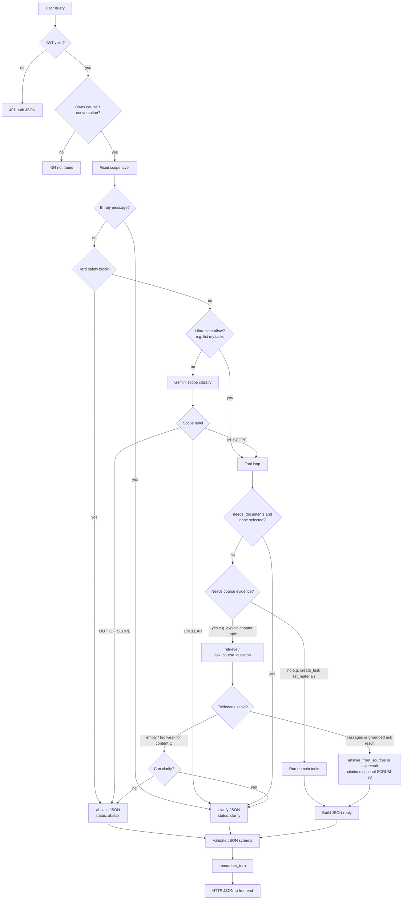

# Pandu Agent Architecture (SCRUM-121)

Status: **AGREED — design contract for turning Pandu into a tool-calling agent**

This document records the team agreements for Pandu as an interactive study agent:
tool inventory, ownership rules, package layout, JSON responses, durable chat
memory, failure handling, and explicit non-goals.

Related contracts: [course workspace](../course-workspace.md),
[API contract — conversations](../api-contract.md),
[Gemini generation](../gemini-generation.md),
[database schema](../database-schema.md).

---

## 1. Goals

- Pandu can remember course-chat context across visits.
- Pandu can choose tools (materials, RAG Q&A, notes, quizzes, tasks, guardrails).
- Every mutating tool enforces JWT authentication and course/conversation ownership
  so one student cannot access another student’s course.
- Pandu always returns a structured JSON reply to the client.
- SCRUM-23: Pandu must still reply when citations are missing or invalid; citations
  are preferred when grounded excerpts exist, but are not required to answer.
- Out-of-scope and unclear queries use a **hybrid scope check layer**: tiny
  deterministic fixed layer, then Gemini for everything else, then post-evidence.
  Full query flow diagram and examples: **§4.1**.

## 2. Non-goals (v1)

- Calendar / study-session tools (existing calendar UI is enough; agent CRUD would
  be over-engineering for v1).
- Moving `backend/apps/conversations/` into the agent package.
- Putting Pandu runtime code under `.claude/agents/` (that path is for IDE helper
  agents only).
- Trusting the LLM with direct database access.

---

## 3. Package layout

Keep domain apps where they are. Add an agent orchestration app that **calls**
them.

```text
backend/apps/conversations/     # Conversation, uploads, questions, ConversationMessage
backend/apps/knowledge/         # retrieval + grounded answer services
backend/apps/notes/             # note generation / fetch
backend/apps/quizzes/           # quiz generation / fetch
backend/apps/courses/           # tasks (todos), course ownership
backend/apps/agent/             # NEW orchestration app
  pandu/
    loop.py                     # model ↔ tool loop
    prompts.py
    schema.py                   # forced JSON reply shape + validation
    scope.py                    # out-of-scope / in-scope check layer
    tools/
      registry.py               # tool name → handler + declaration
      …                        # one module per tool or domain group
```

Suggested HTTP entry (exact path may be finalized at implementation):

```text
POST /api/v1/agent/pandu/
Authorization: Bearer <access-token>
```

Frontend stays thin: send the user message (and conversation/course ids) → render
the JSON reply. Tool calling runs only on the backend.

### Why conversations stays put

`conversations` owns chat **data and HTTP** (scope, uploads, ask). `agent/pandu`
owns the **tool loop**. Moving conversations under `agent/` would blur domain
boundaries, break existing course-chat clients, and create migration/import churn
with no behavior gain. New message persistence belongs next to `Conversation`.

---

## 4. Runtime flow

```text
User message
    → Django Pandu agent endpoint (JWT)
    → load course/conversation context + recent history
    → Scope check layer (see §4.1)
         ├─ OUT_OF_SCOPE → abstain JSON (skip tool loop)
         ├─ UNCLEAR → clarify JSON (or one clarify tool turn)
         └─ IN_SCOPE → continue
    → Gemini chooses zero or more tools
    → each tool handler runs in Django (ORM / existing services)
    → Evidence / post-tool scope gate (weak or empty evidence may abstain/clarify)
    → model produces final reply
    → backend validates JSON schema (repair once if needed)
    → persist turns (remember)
    → HTTP JSON response to frontend
```

- The **model never opens a DB connection**.
- **Tool implementations** hit the database when needed (ownership, chunks, tasks,
  notes, quizzes, messages).
- **Scope is not “model vibes only.”** A dedicated check layer runs before tools and
  again after retrieval/ask when evidence is empty or too weak.

### 4.1 Scope check layer (hybrid)

Add `pandu/scope.py` as an explicit gate **before** the tool loop. Use a **hybrid**
approach: a **tiny fixed layer** for obvious/safe cases, then **Gemini** for open
student language. Do **not** grow a large keyword encyclopedia.

#### Fixed layer (deterministic, keep tiny)

Always runs first:

| Check | Action |
|-------|--------|
| JWT invalid/expired | `401` — stop |
| Course/conversation not owned | `404` — stop |
| Empty / whitespace-only message | `clarify` or `400` — no Gemini, no tools |
| Optional hard safety blocks (e.g. clear prompt-injection / disallowed categories the team explicitly lists) | `abstain` — skip Gemini and tools |

Optional **ultra-clear allows** (2–3 max, exact or near-exact intents only), e.g.:

- “list my tasks” → `IN_SCOPE`, `needs_documents: false` → tools (skip Gemini)
- “list my materials” → same pattern

If the fixed allow does not match, **fall through to Gemini**. Never encode a long
deny-list of topics like “weather” / “roommate” as the main scope brain.

#### Gemini layer (primary classifier)

For everything the fixed layer does not settle, call **Gemini** with structured
JSON output. Backend **enforces** the returned label.

**Prompt context (guidance for Gemini, not a code rule engine):** Pandu helps with
the current owned course/conversation — materials Q&A, notes, quizzes, tasks,
material status, chat uploads. Refuse unrelated or cross-user asks; ask to clarify
when intent or documents are ambiguous.

```json
{
  "label": "IN_SCOPE" | "OUT_OF_SCOPE" | "UNCLEAR",
  "needs_documents": true,
  "reason": "short rationale"
}
```

Validate that shape on the backend. On invalid/malformed scope JSON: one repair
retry, then safe `clarify` or `error` — never invent a tool plan.

#### Document selection policy

| Intent (from fixed allow or Gemini) | Document selection required? | If missing |
|--------|------------------------------|------------|
| Course-material Q&A, notes generation, quiz from materials (`needs_documents: true`) | **Yes** — user must select ≥1 READY document (multi-select allowed, same 1–20 cap as today) | Agent **`clarify`**: ask the user to **select or upload** materials. Do not invent an answer from unselected/all course files. |
| Tasks (list / create / update / complete), list materials, document status, and similar non-grounded tools (`needs_documents: false`) | **No** | Proceed with empty `document_ids`. |
| Out of scope (`OUT_OF_SCOPE`) | N/A | **`abstain`** (skip tools) — same path regardless of selection. |

**Frontend:** do not blanket-disable Send when nothing is selected. Require selection only when the turn needs grounded materials / notes / quiz generation. Non-material intents must be sendable with zero documents selected.

#### How the check works

1. **Fixed layer** — auth/ownership, empty input, optional hard safety, optional 2–3 clear allows.  
2. **Gemini layer** (if not settled) — classify `IN_SCOPE` / `OUT_OF_SCOPE` / `UNCLEAR`.  
   - `OUT_OF_SCOPE` → abstain JSON; **do not** call RAG/notes/quizzes.  
   - `UNCLEAR` → clarify JSON (or allow only `clarify`).  
   - `IN_SCOPE` → tool loop. If `needs_documents` and selection is empty →
     `clarify` (select/upload) before materials tools.  
3. **Post-tool evidence gate** — after `retrieve_chunks` / `ask_course_question`,
   if passages are empty or ungrounded **and** the question needed course evidence,
   force `abstain` or `clarify` instead of inventing. SCRUM-23: answer with
   `citations: []` when passages exist but citation excerpts fail; empty evidence
   for a content question ≠ invent.  
4. **Final JSON status** must match the gate: `abstain` / `clarify` / `ok`.

#### Query flow (by query)

Compact path:

```text
User query
  → JWT? no → 401
  → Owns course/conversation? no → 404
  → Fixed scope layer
       → empty message → clarify/400
       → hard safety hit → abstain
       → ultra-clear allow (e.g. list my tasks) → IN_SCOPE (skip Gemini)
       → else → Gemini scope classify
            → OUT_OF_SCOPE → abstain (no tools)
            → UNCLEAR      → clarify
            → IN_SCOPE     → tool loop
                 → needs_documents and none selected → clarify (select/upload)
                 → needs course evidence?
                      → no  → domain tools (tasks / materials / notes / quiz)
                      → yes → retrieve / ask
                           → evidence usable?
                                → no  → abstain or clarify (do not invent)
                                → yes → answer (citations optional, SCRUM-23)
  → validate JSON → remember_turn → HTTP JSON
```

Full diagram:



#### Example queries

| User query | Gate | Result |
|------------|------|--------|
| “What does lecture 3 say about recursion?” | `IN_SCOPE` | ask/retrieve → answer (citations if possible) |
| “Generate a 5-question quiz from my READY PDFs” | `IN_SCOPE` | `generate_quiz` |
| “Mark my ‘Read ch.2’ task done” | `IN_SCOPE` | `complete_task` |
| “Which PDF should I use?” (no materials picked, several READY) | `UNCLEAR` | `clarify` — ask to select/upload |
| “What does lecture 3 say…?” with **no** docs selected | `UNCLEAR` | `clarify` — ask to select/upload; no grounded answer |
| “List my tasks” (exact allow) with **no** docs selected | Fixed allow → `IN_SCOPE` | Skip Gemini; selection not required |
| “Is Lecture.pdf READY?” with **no** docs selected | Gemini → `IN_SCOPE` | Allowed — selection not required |
| “What’s the weather in Austin?” | Gemini → `OUT_OF_SCOPE` | `abstain`, skip tools (not a fixed keyword list) |
| “Summarize my roommate’s CS course” | `OUT_OF_SCOPE` | `abstain` / ownership 404 — never cross user |
| “Explain paging” but retrieve returns no chunks | `IN_SCOPE` → evidence fail | `abstain` or `clarify` (do not invent) |
| “Explain paging” with passages but bad citation excerpts | `IN_SCOPE` + evidence ok | answer with `citations: []` (SCRUM-23) |

### Tool failure in the loop

A failed tool is a structured result, not a crashed request:

1. Handler catches the error.
2. Returns `{ "ok": false, "code": "...", "message": "..." }` to the model.
3. Model may retry with different args, call `clarify`, call `abstain`, or explain
   to the user.
4. The user still receives a JSON reply unless auth is invalid.

Mutating tools: prefer **one tool = one DB transaction**. If tool A succeeds and
tool B fails in the same turn, A’s commit stands; the reply must say what finished
and what failed. Cap automatic retries (for example one). Reuse existing
idempotency keys (`creation_key` on tasks) so retries do not double-create.
Never leak stack traces or other users’ data.

Hard stop: expired/invalid JWT → stop loop, return auth error JSON.

---

## 5. Hard security rule

| Kind | Rule |
|------|------|
| All tools | Require authenticated JWT user from the request. |
| Mutating tools | JWT **and** ownership of the target course and/or conversation. |
| Reads | Same ownership scope; never return another student’s rows. |
| Missing / foreign ids | Same `404` body as existing StudyForge APIs (do not reveal existence). |

Ownership follows existing helpers (`owned_course`, `owned_conversation`, and the
course-owner checks already used by notes, quizzes, and RAG).

---

## 6. Database changes

### Required for durable memory

Today `Conversation` exists but **messages are not persisted** (frontend
`sessionStorage` only). For `remember_turn` / `recall_history`, add:

**`ConversationMessage`** (in `backend/apps/conversations/`)

| Column | Type | Notes |
|--------|------|--------|
| `id` | big auto PK | |
| `conversation` | FK → `Conversation`, `CASCADE` | |
| `role` | varchar | `user` \| `assistant` \| `tool` \| `system` |
| `content` | text or JSON | body; JSON allowed for citations / tool payloads |
| `created_at` | timestamptz | `auto_now_add` |

Index: `(conversation_id, created_at)` for ordered recall.

Ownership is enforced through `conversation.owner` (and course owner when the
conversation is course-linked). No separate `owner` column on the message.

Optional later (not required for first migration): `citations` JSON, `tool_name`,
`tool_call_id`.

### Not required for v1 tools

No new tables for materials, chunks, notes, quizzes, or tasks — tools wrap
existing APIs and models. No calendar tables for the agent.

### Client cache

`sessionStorage` may remain a **UI cache**. The database is the source of truth
for conversation messages after this change.

---

## 7. JSON response contract

Every successful or handled Pandu agent HTTP response body is JSON. Do not return
free-form prose as the top-level body.

Enforce in the backend (not prompt-only):

1. Provider structured-output / JSON mode where available.
2. Validate against the schema below before responding.
3. On invalid shape: one repair attempt, then a safe `status: "error"` JSON body.

### Reply schema

```json
{
  "type": "message",
  "status": "ok",
  "text": "Human-readable reply for the student.",
  "citations": [],
  "tool_trace": []
}
```

| Field | Meaning |
|-------|---------|
| `type` | Always `"message"` for the student-facing reply envelope. |
| `status` | `ok` \| `clarify` \| `abstain` \| `error` |
| `text` | What the UI shows. Required nonempty string for `ok` / `clarify` / `abstain`. |
| `citations` | Array; **may be empty** (SCRUM-23). Prefer exact grounded excerpts when available. |
| `tool_trace` | Optional internal/debug summary of tools used; may be empty or omitted in production UI. |

Auth failures use the existing API error JSON patterns (`401`, etc.) rather than
this envelope when the request never enters the agent loop.

Tool-call payloads between model and host are internal. Only this envelope (or a
standard API error) is returned to the frontend.

---

## 8. Finalized tool inventory (v1)

Quiz tools **call the existing quiz feature**; they do not mean Pandu already owned
quiz generation before this work. Calendar / study-session tools are **out of v1**.

**Shared rules for every tool**

- Caller identity comes only from the request **JWT** (never from tool args).
- Resource ids in args are resolved with existing ownership helpers; missing or
  foreign ids → same **404** body as the rest of StudyForge.
- Tool failures return `{ "ok": false, "code": "<CODE>", "message": "<safe text>" }`
  to the model (see §4). Success payloads below are the `ok: true` / direct result
  bodies the model sees.

### 8.0 Overview

| Tool | Mutates | One-line purpose |
|------|---------|------------------|
| `get_course_context` | no | Where the user is (course / conversation). |
| `recall_history` | no | Load recent owned chat messages. |
| `remember_turn` | **yes** | Persist a chat turn. |
| `list_materials` | no | List owned course documents. |
| `get_document_status` | no | Status for one owned document. |
| `list_conversation_uploads` | no | List chat uploads for this conversation. |
| `retrieve_chunks` | no | RAG passages only. |
| `ask_course_question` | no* | Grounded Q&A via conversation questions API. |
| `answer_from_sources` | no | Reply from already-retrieved passages. |
| `generate_notes` | **yes** | Existing notes generation. |
| `get_notes` | no | Fetch existing notes. |
| `generate_quiz` | **yes** | Existing quiz generation. |
| `get_quiz` | no | Fetch an owned quiz. |
| `list_tasks` | no | List owned to-dos. |
| `create_task` | **yes** | Create a to-do. |
| `update_task` | **yes** | Title/due update when that API exists. |
| `complete_task` | **yes** | Toggle completion. |
| `delete_task` | **yes** | Delete when that API exists (omit until then). |
| `clarify` | no | Ask the user a follow-up. |
| `abstain` | no | Safe refusal. |

\*Document query-only; persist the turn with `remember_turn`.

**Q&A usage:** prefer `ask_course_question` for normal asks. Use
`retrieve_chunks` → `answer_from_sources` for multi-step control. Do **not** run
both paths in the same user turn.

### 8.1 Tool contracts (inputs, outputs, ownership)

#### Context and memory

**`get_course_context`** — Explains *where* Pandu is so later tools use the right
course/conversation. Does not load full chat history.

| | |
|--|--|
| **Ownership** | JWT user must own `course_id` / `conversation_id` when provided. |
| **Inputs** | `course_id?: int`, `conversation_id?: int` (at least one required in course chat). |
| **Outputs** | `{ course: { id, title } \| null, conversation: { id, title, course_id } \| null }` |
| **Errors** | `RESOURCE_NOT_FOUND`, `AUTHENTICATION_REQUIRED` |

**`recall_history`** — Loads recent `ConversationMessage` rows so Pandu can continue
the thread after refresh.

| | |
|--|--|
| **Ownership** | JWT; `conversation_id` must be owned (and course-owned when linked). |
| **Inputs** | `conversation_id: int` (required), `limit?: int` (default e.g. 20, capped). |
| **Outputs** | `{ messages: [{ id, role, content, created_at }] }` oldest→newest within the window |
| **Errors** | `RESOURCE_NOT_FOUND` |

**`remember_turn`** — Writes user/assistant/tool content to the DB (durable memory).

| | |
|--|--|
| **Ownership** | JWT; owned conversation only. **Mutating.** |
| **Inputs** | `conversation_id: int`, `role: "user"|"assistant"|"tool"|"system"`, `content: string \| object` |
| **Outputs** | `{ id, conversation_id, role, created_at }` |
| **Errors** | `RESOURCE_NOT_FOUND`, validation errors |

#### Materials and uploads

**`list_materials`** — Lists course documents the student owns (for status checks and
picking context). Selection for Q&A still comes from the UI `document_ids`.

| | |
|--|--|
| **Ownership** | JWT; `course_id` owned. |
| **Inputs** | `course_id: int` (required) |
| **Outputs** | `{ documents: [{ id, title, status, created_at }] }` |
| **Errors** | `RESOURCE_NOT_FOUND` |

**`get_document_status`** — One document’s processing state (`PENDING` / `PROCESSING` /
`READY` / `FAILED`).

| | |
|--|--|
| **Ownership** | JWT; document owned by caller (course material or accessible upload). |
| **Inputs** | `document_id: int` (required) |
| **Outputs** | `{ id, title, status, error? }` |
| **Errors** | `RESOURCE_NOT_FOUND` |

**`list_conversation_uploads`** — Chat-scoped uploads (not the normal course material
list).

| | |
|--|--|
| **Ownership** | JWT; owned conversation. |
| **Inputs** | `conversation_id: int` (required) |
| **Outputs** | `{ documents: [{ id, title, status, conversation_id }] }` |
| **Errors** | `RESOURCE_NOT_FOUND` |

#### Grounded Q&A

**`retrieve_chunks`** — Vector search only; does not write the student-facing answer.

| | |
|--|--|
| **Ownership** | JWT; each id READY and authorized for this conversation/course. |
| **Inputs** | `question: string`, `document_ids: int[]` (1–20 unique), `conversation_id?: int`, `top_k?: int` |
| **Outputs** | `{ passages: [{ chunk_id, document_id, page?, text, score? }] }` (may be `[]`) |
| **Errors** | `RESOURCE_NOT_FOUND`, validation on `document_ids` |

**`ask_course_question`** — Main Q&A path. Wraps
`POST /api/v1/conversations/{id}/questions/`. Citations optional (SCRUM-23).

| | |
|--|--|
| **Ownership** | JWT; owned conversation; each `document_id` READY in that conversation or its course. |
| **Inputs** | `conversation_id: int`, `question: string`, `document_ids: int[]` (1–20 unique) |
| **Outputs** | `{ status: "ANSWERED"|"INSUFFICIENT_CONTEXT", answer: string\|null, citations: [{ chunk_id, document_id, page?, excerpt }] }` — `citations` may be `[]` |
| **Errors** | `RESOURCE_NOT_FOUND`, `RAG_GENERATION_FAILED` (safe 503-style tool error) |

**`answer_from_sources`** — Builds a reply from passages already in hand (after
`retrieve_chunks`). Prefer exact citations; allow uncited helpful text (SCRUM-23).

| | |
|--|--|
| **Ownership** | No extra DB read required if passages were already authorized; do not accept foreign chunk ids the handler did not just retrieve. |
| **Inputs** | `question: string`, `passages: [{ chunk_id, document_id, page?, text }]`, `allow_uncited?: boolean` (default true) |
| **Outputs** | `{ status: "ANSWERED"|"INSUFFICIENT_CONTEXT", answer: string\|null, citations: [...] }` — `citations` may be `[]` |
| **Errors** | Invalid passage payload → tool validation error |

#### Notes

**`generate_notes`** — Calls the existing course notes API for selected READY
materials.

| | |
|--|--|
| **Ownership** | JWT; owned `course_id`; each document READY and owned in that course. **Mutating.** |
| **Inputs** | `course_id: int`, `document_ids: int[]` (required, nonempty READY set per notes API) |
| **Outputs** | Notes payload as returned by the existing notes create API (id, content/sections, sources as defined there) |
| **Errors** | `RESOURCE_NOT_FOUND`, not-ready documents, generation failures (sanitized) |

**`get_notes`** — Fetches notes already generated for this student.

| | |
|--|--|
| **Ownership** | JWT; note owned by caller (via course ownership). |
| **Inputs** | `note_id: int` (required) |
| **Outputs** | Existing note detail payload |
| **Errors** | `RESOURCE_NOT_FOUND` |

#### Quizzes

**`generate_quiz`** — Calls existing `POST /api/v1/courses/{id}/quizzes/`.

| | |
|--|--|
| **Ownership** | JWT; owned course; READY owned materials. **Mutating.** |
| **Inputs** | `course_id: int`, `document_ids: int[]`, `num_questions: 5 \| 10` |
| **Outputs** | Quiz summary without hidden answers (id, questions with options only, per existing API) |
| **Errors** | `RESOURCE_NOT_FOUND`, `DOCUMENT_NOT_READY`, generation failures |

**`get_quiz`** — Fetches an owned quiz (`GET /api/v1/quizzes/{id}/`).

| | |
|--|--|
| **Ownership** | JWT; quiz owner = caller. |
| **Inputs** | `quiz_id: int` |
| **Outputs** | Existing quiz detail payload (`is_submitted`, questions without answers until submitted rules apply) |
| **Errors** | `RESOURCE_NOT_FOUND` |

#### Tasks

**`list_tasks`** — Lists to-dos the student owns.

| | |
|--|--|
| **Ownership** | JWT; only todos whose `course.owner` is the caller. |
| **Inputs** | `course_id?: int` (if set, must be owned; filters to that course) |
| **Outputs** | `{ tasks: [{ id, title, course_id, due_date, is_completed, created_at }] }` |
| **Errors** | `RESOURCE_NOT_FOUND` if `course_id` foreign |

**`create_task`** — Creates a to-do on an owned course (existing todos API +
`creation_key` idempotency).

| | |
|--|--|
| **Ownership** | JWT; `course_id` owned. **Mutating.** |
| **Inputs** | `course_id: int`, `title: string`, `creation_key: uuid`, `due_date?: string (YYYY-MM-DD)` |
| **Outputs** | `{ id, title, course_id, due_date, is_completed }` |
| **Errors** | `RESOURCE_NOT_FOUND`, validation, `409` if `creation_key` reused with different payload |

**`update_task`** — Updates title/due date **when that API exists**. Until then, omit
from the live registry (completion is separate).

| | |
|--|--|
| **Ownership** | JWT; todo’s course owned. **Mutating.** |
| **Inputs** | `task_id: int`, `title?: string`, `due_date?: string \| null` |
| **Outputs** | Updated task object |
| **Errors** | `RESOURCE_NOT_FOUND`, validation |

**`complete_task`** — Maps to existing completion PATCH
(`is_completed` true/false).

| | |
|--|--|
| **Ownership** | JWT; todo’s course owned. **Mutating.** |
| **Inputs** | `task_id: int`, `is_completed: boolean` |
| **Outputs** | Updated task object |
| **Errors** | `RESOURCE_NOT_FOUND`, validation |

**`delete_task`** — Only after a delete endpoint ships; omit from registry until then.

| | |
|--|--|
| **Ownership** | JWT; todo’s course owned. **Mutating.** |
| **Inputs** | `task_id: int` |
| **Outputs** | `{ ok: true }` |
| **Errors** | `RESOURCE_NOT_FOUND` |

#### Guardrails

**`clarify`** — Asks the user a short follow-up (missing docs, ambiguous intent).
Also produced by the hybrid scope layer (§4.1). No DB write.

| | |
|--|--|
| **Ownership** | N/A (no resource access). |
| **Inputs** | `prompt: string` (question to show the user) |
| **Outputs** | `{ status: "clarify", text: string }` → drives final JSON `status: "clarify"` |
| **Errors** | none beyond empty `prompt` validation |

**`abstain`** — Positive denial when out of scope or evidence is unusable. No
invented answer. Also produced by the scope layer.

| | |
|--|--|
| **Ownership** | N/A. |
| **Inputs** | `reason: string` (safe, user-facing) |
| **Outputs** | `{ status: "abstain", text: string }` → final JSON `status: "abstain"` |
| **Errors** | none beyond empty `reason` validation |

`clarify` / `abstain` may short-circuit before any other tool runs.

---

## 9. SCRUM-23 citation policy

Current grounded chat can fail or withhold a useful reply when citations are
missing or fail exact-excerpt validation. SCRUM-23 fixes that product behavior.

Agent rules:

- Prefer citations that are exact excerpts from retrieved passages.
- If no valid citation can be produced, still return `status: "ok"` with helpful
  `text` and `citations: []` when the answer is appropriate.
- If the question is out of scope or evidence is too weak to say anything useful,
  use `abstain` or `clarify` instead of fabricating sources.

---

## 10. Implementation sequence (suggested)

1. Add `ConversationMessage` model + migration; document in `database-schema.md`.
2. Scaffold `backend/apps/agent/` with Pandu loop, tool registry, JSON schema
   validation, and `scope.py` check layer.
3. Register tools that wrap existing services (ask, materials, notes, quizzes,
   tasks) with ownership checks.
4. Wire hybrid scope gate (tiny fixed layer + Gemini) and post-tool evidence gate
   to `abstain` / `clarify`.
5. Wire `remember_turn` / `recall_history` to the new message table.
6. Point course chat at the agent endpoint; keep `sessionStorage` as cache only.
7. Align frontend with the JSON reply envelope.
8. Tests: ownership isolation per mutating tool, JSON schema enforcement, SCRUM-23
   uncited reply path, fixed-layer short-circuits, Gemini out-of-scope path,
   empty-retrieval abstain/clarify, tool-failure recovery.

---

## 11. Agreement summary

| Topic | Decision |
|-------|----------|
| Agent location | `backend/apps/agent/pandu/` |
| Conversations app | Stays at `backend/apps/conversations/`; extended with messages |
| Calendar tools | Out of v1 |
| Quiz tools | Wrap existing quiz feature |
| Memory | DB `ConversationMessage` now; browser is cache only |
| DB access | Tool handlers only; model never touches DB |
| Client contract | Always JSON reply envelope |
| Citations | Optional; reply without them (SCRUM-23) |
| Mutating tools | JWT + course/conversation ownership |
| Scope | **Hybrid:** tiny fixed layer (auth, empty input, optional hard safety, ≤2–3 clear allows) then **Gemini** for the rest; evidence gate after retrieve/ask; no large keyword encyclopedia |
| Doc selection | Required for material Q&A / notes / quiz; not for tasks / list materials / status; missing → clarify select/upload; out of scope still abstain |
| Tool contracts | §8.1 defines per-tool inputs, outputs, ownership, and errors (AC2) |
| Client JSON | §7 response envelope agreed for frontend (Nischal) |

Approval basis: design discussion for SCRUM-121 Pandu agent architecture
(November 2026).
